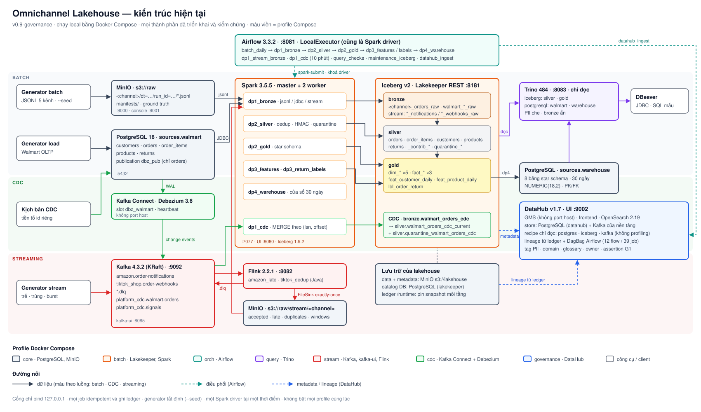
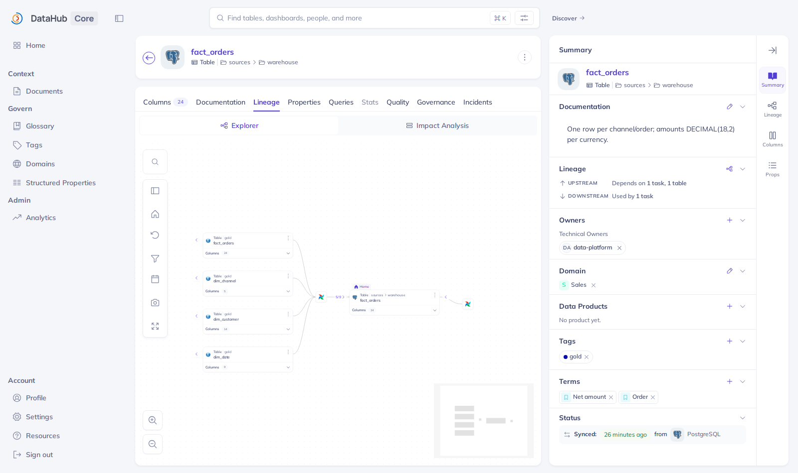

# Omnichannel Lakehouse

[](https://github.com/tri21723/omnichannel-lakehouse/actions/workflows/ci.yml)


Nền tảng dữ liệu end-to-end cho thương mại điện tử **5 kênh** (Walmart, Amazon, TikTok Shop, Shopee,
Lazada): batch, streaming và CDC hội tụ vào một lakehouse Apache Iceberg, được mô hình hoá thành star
schema, feature store và data warehouse, truy vấn bằng Trino, điều phối bằng Airflow và quản trị bằng
DataHub. Toàn bộ chạy **local bằng Docker Compose**, mỗi thành phần được pin version và có bằng chứng
kiểm chứng.

> Tổng quan chi tiết về mọi luồng dữ liệu: **[docs/project-overview.md](docs/project-overview.md)**.

---

## Mục lục

- [Điểm nổi bật](#điểm-nổi-bật)
- [Kiến trúc](#kiến-trúc)
- [Công nghệ](#công-nghệ)
- [Trạng thái](#trạng-thái)
- [Yêu cầu hệ thống](#yêu-cầu-hệ-thống)
- [Bắt đầu nhanh](#bắt-đầu-nhanh)
- [Chạy từng luồng](#chạy-từng-luồng)
- [Kiểm thử và CI](#kiểm-thử-và-ci)
- [Cấu trúc repo](#cấu-trúc-repo)
- [Tài liệu](#tài-liệu)
- [Đóng góp](#đóng-góp)
- [Giấy phép](#giấy-phép)

---

## Điểm nổi bật

- **Medallion trên Iceberg v2** (Bronze → Silver → Gold) qua REST catalog Lakekeeper; mọi job
  **idempotent** (`MERGE` / thay thế theo slice) — chạy lại không nhân đôi dữ liệu.
- **Ledger và snapshot pin**: mỗi tầng ghi lại chính xác snapshot của tầng trước mà nó đã đọc, nên kết
  quả tái lập được và lineage kiểm chứng được.
- **Dữ liệu "khó" có chủ đích**: generator tất định (`--seed`) sinh trùng, trễ, lệch schema, skew và
  burst — kèm ground truth để đối soát.
- **Streaming exactly-once** với Flink: event-time, watermark, cửa sổ, dedup có TTL, event quá trễ đi
  side output/DLQ, phục hồi từ checkpoint.
- **CDC đúng thứ tự** từ WAL PostgreSQL qua Debezium, áp dụng theo `(lsn, offset)`, xoá mềm, đối soát
  PostgreSQL ↔ Silver.
- **Feature store point-in-time** và return label có right-censoring (không rò rỉ nhãn).
- **Bảo vệ PII**: hash HMAC từ Silver, che cột trong Trino, ingestion metadata không đọc dòng, tag `PII`
  trong DataHub.
- **Lineage tự kiểm**: lineage phát từ ledger, assertion G1 fail khi thiếu bất kỳ cạnh nào.
- **18 ADR**, runbook, tài liệu kiểm chứng theo từng phase, CI với log chỉ in sự kiện trong allowlist.

---

## Kiến trúc



*Hệ thống hoàn chỉnh (v0.9-governance); màu viền theo profile Docker Compose.*

| Luồng | Đường đi |
|---|---|
| **Batch** | JSONL 5 kênh (MinIO) + PostgreSQL JDBC → Spark → Iceberg Bronze/Silver/Gold → PostgreSQL `warehouse` (30 ngày) |
| **Streaming** | Generator → Kafka → Flink (trễ, trùng, burst) → MinIO → Bronze |
| **CDC** | WAL PostgreSQL → Debezium → Kafka → Spark `dp1_cdc` → Bronze/Silver |
| **Query** | Trino (Iceberg REST + PostgreSQL) → DBeaver |
| **Orchestration** | Airflow điều phối mọi job, một Spark driver tại một thời điểm |
| **Governance** | DataHub: catalog, lineage, tag/domain/glossary, assertion G1 |

Chi tiết từng luồng, ledger và nguyên tắc thiết kế: [project overview](docs/project-overview.md) ·
sơ đồ Mermaid: [architecture](docs/architecture.md).

---

## Công nghệ

| Lớp | Công nghệ (đã pin) |
|---|---|
| Storage | PostgreSQL 16 · MinIO (S3) |
| Table format / catalog | Apache Iceberg 1.9.2 · Lakekeeper (REST catalog) |
| Batch | Apache Spark 3.5.5 (master + 2 worker) |
| Streaming | Apache Kafka 4.3.2 (KRaft) · Apache Flink 2.2.1 (Java) |
| CDC | Debezium 3.6.3 (Kafka Connect) |
| Orchestration | Apache Airflow 3.3.2 |
| Query | Trino 484 · DBeaver |
| Governance | DataHub v1.7.0.1 · OpenSearch 2.19.3 |
| Tooling | Python 3.11 · Docker Compose · GNU Make · ruff/black/sqlfluff/yamllint · pytest |

Lý do chọn và nguồn của từng phiên bản: [ADR-0001](docs/adr/0001-versions.md).

---

## Trạng thái

| Phase | Nội dung | Trạng thái |
|---|---|---|
| 0–3 | Nền tảng, core storage, generator, Iceberg + Lakekeeper + Spark | ✅ `v0.3-phase3` |
| 4A–4F | Bronze, Silver, Gold, feature/label, warehouse export, benchmark skew | ✅ `v0.4a-bronze` … `v0.4f-benchmark` |
| 5 | Airflow orchestration, backfill idempotent | ✅ `v0.5-orchestration` |
| 6 | Trino query layer chỉ đọc + DBeaver | ✅ `v0.6-query` |
| 7 | Kafka + Flink streaming | ✅ `v0.7-stream` |
| 8 | Debezium CDC | ✅ `v0.8-cdc` |
| 9 | DataHub governance | ✅ `v0.9-governance` |

Dự án hoàn thành ở Phase 9. Chi tiết: [implementation status](docs/implementation-status.md).

---

## Yêu cầu hệ thống

- Docker Engine hoặc Docker Desktop có Compose v2; internet cho lần build đầu.
- Python 3.11 (3.12 được hỗ trợ cho kiểm tra scaffold) và GNU Make.
- RAM: **16 GB tối thiểu**, 32 GB thoải mái. Mỗi cụm là một profile riêng — **không bật tất cả cùng
  lúc** (bảng RAM theo profile trong [project overview](docs/project-overview.md#4-hạ-tầng-local)).
- WSL2 được hỗ trợ (xem [runbook](docs/runbook.md) về Docker credential helper).

---

## Bắt đầu nhanh

```sh
git clone https://github.com/tri21723/omnichannel-lakehouse.git
cd omnichannel-lakehouse

make setup               # virtualenv + công cụ dev đã pin
make env                 # sinh .env với credential ngẫu nhiên (không commit)
make check               # lint + unit test, không cần Docker
make help                # liệt kê mọi lệnh
```

Dựng core storage và sinh dữ liệu nguồn:

```sh
make up-core smoke-core  # PostgreSQL :5432, MinIO :9000 (console :9001)
make build-generator
make gen-sources         # 15.600 dòng JSONL (15.000 đơn) trên MinIO + 3.000 đơn Walmart trong PostgreSQL
make verify-sources
```

Dựng lakehouse và chạy pipeline batch trên fixture nhỏ:

```sh
make env-silver build-batch up-batch   # Lakekeeper :8181, Spark :7077 / UI :8080
make prepare-silver-fixture            # fixture 375 đơn + Bronze
make integration-silver                # Silver
make smoke-gold smoke-features smoke-labels smoke-warehouse   # Gold → feature/label → warehouse
```

`make down` dừng mọi dịch vụ và **giữ volume**. Credential nằm trong `.env`; các lệnh smoke/verify
chạy tuần tự (không chạy song song nhiều Spark driver).

---

## Chạy từng luồng

<details>
<summary><b>Lakehouse và Bronze (Phase 3, 4A)</b></summary>

```sh
make env-batch build-batch up-batch
make smoke-lakehouse restart-lakehouse verify-lakehouse verify-objects-lakehouse
make smoke-bronze        # Walmart JSONL + 5 bảng JDBC, replay và đối soát
```

Lakekeeper UI: http://localhost:8181/ui/ · Spark UI: http://localhost:8080.
Bronze giữ nguyên payload (`_raw`), thêm cột audit, ghi completion record sau khi đối soát.
[Bronze contract](docs/bronze-contract.md) · [ADR-0007](docs/adr/0007-bronze-ingestion.md) ·
[lakehouse validation](docs/lakehouse-validation.md) · [Bronze validation](docs/bronze-validation.md)
</details>

<details>
<summary><b>Silver (Phase 4B)</b></summary>

```sh
make env-silver build-generator build-batch up-batch
make prepare-silver-fixture integration-silver
make test-silver-dq test-silver-recovery reconcile-silver verify-silver
make integration-silver-reference      # dataset mặc định 15.000 đơn (sau khi đủ Bronze)
```

5 entity × 5 kênh, dedup theo `updated_ts` + hash chuẩn hoá, PII → HMAC, bản ghi lỗi vào
`quarantine_*`. Giữ nguyên HMAC key/version trong `.env` khi replay.
[ADR-0008](docs/adr/0008-silver-contract.md) · [Silver validation](docs/silver-validation.md)
</details>

<details>
<summary><b>Gold, feature/label, warehouse (Phase 4C–4E)</b></summary>

```sh
make smoke-gold verify-gold
make test-gold-dq reconcile-gold GOLD_RUN_ID=186ae107d0793d2ee237
make test-gold-recovery

make smoke-features verify-features smoke-labels verify-labels
make integration-dp3 test-dp3-dq DP3_RUN_ID=186ae107d0793d2ee237 test-dp3-recovery

make smoke-warehouse verify-warehouse reconcile-warehouse
make test-warehouse-dq test-warehouse-recovery
```

- **Gold:** star schema 8 bảng, surrogate key SHA-256, tiền tệ `DECIMAL(18,2)` khớp tuyệt đối với
  Silver/Bronze. [ADR-0009](docs/adr/0009-gold-star-schema.md) · [Gold validation](docs/gold-validation.md)
- **DP3:** `feat_customer_daily`, `feat_product_daily`, `lbl_order_return` với cutoff point-in-time và
  maturity censoring. [ADR-0010](docs/adr/0010-features-and-return-labels.md) · [DP3 validation](docs/dp3-validation.md)
- **Warehouse:** cửa sổ 30 ngày UTC sang PostgreSQL `warehouse.*` trong một giao dịch JDBC.
  [ADR-0011](docs/adr/0011-warehouse-export.md) · [warehouse validation](docs/warehouse-validation.md)
</details>

<details>
<summary><b>Airflow (Phase 5)</b></summary>

```sh
make env-orch build-orch
make up-orch             # UI http://localhost:8081 — admin / AIRFLOW_ADMIN_PASSWORD trong .env
make smoke-orch test-dags
make e2e                 # backfill batch_daily 2026-01-01..03, chạy lại cho cùng kết quả
```


Mỗi job một DAG cùng tên (`dp1_bronze` … `dp4_warehouse`); `batch_daily` gọi lần lượt cho cùng ngày
logic. Airflow là Spark driver (client mode), dùng chung ledger và khoá driver với `make`.
`maintenance_iceberg` chỉ báo cáo (`make iceberg-report`).
[ADR-0013](docs/adr/0013-airflow-orchestration.md) · [orchestration validation](docs/orchestration-validation.md)
</details>

<details>
<summary><b>Trino + DBeaver (Phase 6)</b></summary>

```sh
make up-query            # Trino 127.0.0.1:8083 (không cần Spark/Airflow)
make smoke-query         # catalog, PII bị che, mọi lệnh ghi bị từ chối
make query-samples       # 8 query mẫu × mọi dataset
make verify-query        # cần up-batch: Trino = Spark = ledger = warehouse
make query-sql SQL=sql/trino/02_top_sellers.sql PARAMS='dataset_run_id=b1e64afaff0176de180a'
```

Chỉ đọc `iceberg.silver`, `iceberg.gold`, `postgresql.walmart`, `postgresql.warehouse`; Bronze và
benchmark bị ẩn; `full_name`/`email` hiển thị `[redacted]`. Kết nối DBeaver: [docs/dbeaver.md](docs/dbeaver.md).
[ADR-0015](docs/adr/0015-trino-query-layer.md) · [query validation](docs/query-validation.md)
</details>

<details>
<summary><b>Streaming với Kafka + Flink (Phase 7)</b></summary>

```sh
make up-stream           # Kafka 127.0.0.1:9092, kafka-ui :8085, Flink :8082
make smoke-stream
make stream-acceptance   # chạy job, publish 6.312 record (50 rec/s), drain, đối soát ground truth, đóng run
make bronze-stream STREAM_RUN_ID=e7a188e49b1e4042ef15 STREAM_RUN_DATE=2026-02-01   # cần up-batch
```

`amazon_late`: watermark 2 phút, cửa sổ 5 phút, cho trễ 20 phút, event quá trễ ra nhánh riêng.
`tiktok_dedup`: loại trùng theo `event_id`, TTL 30 phút. Record hỏng vào DLQ.
[ADR-0016](docs/adr/0016-streaming-kafka-flink.md) · [streaming validation](docs/streaming-validation.md) ·
[benchmark](docs/benchmarks/streaming.md)
</details>

<details>
<summary><b>CDC với Debezium (Phase 8)</b></summary>

```sh
make up-cdc smoke-cdc    # Kafka Connect + Debezium (không port host), slot, snapshot, thứ tự c/u/u/d
make up-batch
make gen-cdc             # INSERT/UPDATE/DELETE trên tiền tố id riêng (không đụng dataset batch)
make bronze-cdc silver-cdc verify-cdc   # Kafka → Bronze → Silver hiện trạng → đối soát PostgreSQL
make cdc-slot-lag cdc-batch-guard
```

Chỉ bắt `walmart.orders` (không bắt `customers` có PII); Bronze `MERGE` theo toạ độ Kafka; Silver chỉ
nhận bản mới hơn theo `(lsn, offset)`, xoá mềm. DAG `dp1_cdc` chạy mỗi 10 phút.
[ADR-0017](docs/adr/0017-cdc-debezium.md) · [CDC validation](docs/cdc-validation.md)
</details>

<details>
<summary><b>DataHub governance (Phase 9)</b></summary>

```sh
make up-gov              # core + Lakekeeper + Kafka + DataHub; UI http://127.0.0.1:9002
make smoke-gov           # 15 kiểm tra: health, đăng nhập, ghi/đọc/xoá entity thử, quyền chỉ đọc, secret
make gov-refresh         # 3 recipe chỉ đọc + lineage từ ledger + lineage job Airflow + metadata-as-code
make gov-assert          # G1: nguồn → Bronze → Silver → Gold → warehouse, stream, CDC + drift metadata
make gov-idempotency     # chạy lại toàn bộ, inventory phải giống hệt
```



Đăng nhập bằng user `datahub`, mật khẩu sinh trong `.local-data/governance/user.props`. DataHub cần
~3,5 GiB: chỉ chạy cùng core + Kafka (`make up-gov-orch` thêm Airflow cho DAG `datahub_ingest`).
[ADR-0018](docs/adr/0018-governance-datahub.md) · [governance validation](docs/governance-validation.md)
</details>

<details>
<summary><b>Benchmark data skew (Phase 4F)</b></summary>

```sh
make test-benchmark benchmark-dataset verify-benchmark-dataset
make benchmark-skew BENCH_CONFIG=smoke      # smoke | matrix-100k | matrix-1m | focus-1m | ci
make verify-benchmark report-benchmark BENCH_CONFIG=smoke
```

So sánh AQE, broadcast, salting, partitioning trên dataset tới ~1M dòng; 240 trial đều đúng kết quả.
[kết quả](docs/benchmarks/skew.md) · [ADR-0012](docs/adr/0012-skew-benchmark.md)
</details>

---

## Kiểm thử và CI

| Mức | Lệnh / nơi chạy | Nội dung |
|---|---|---|
| Lint + unit | `make check` | ruff, black, sqlfluff, yamllint; hơn 300 test pytest (không cần Docker) |
| DAG | `make test-dags` | DagBag và contract DAG trong image Airflow |
| Tích hợp | `smoke-*`, `verify-*`, `integration-*`, `test-*-recovery` | chạy trên stack thật, tuần tự |
| CI tự động | [`ci.yml`](.github/workflows/ci.yml) | Scaffold checks mỗi lần push |
| CI thủ công | [`.github/workflows/`](.github/workflows/) | `lakehouse`, `bronze`, `silver`, `gold-dp3`, `warehouse`, `benchmark`, `orchestration`, `query`, `stream`, `cdc`, `governance` |

Log CI chỉ in sự kiện JSON trong allowlist (tên check, số đếm, hash) — không in log thô hay dữ liệu.
Các workflow mới (từ Phase 7) được tái hiện trên một Compose project tách biệt trước khi chạy trên GitHub.

---

## Cấu trúc repo

```text
docker/          compose theo profile, Dockerfile (images/), script smoke/init
generators/      batch, load, stream, cdc + cấu hình YAML tái lập
spark/           jobs/ (dp1_bronze, dp2_silver, dp3_*, dp4_warehouse, dp1_cdc), lib/, tests/
flink/           jobs/ (Java: amazon_late, tiktok_dedup)
airflow/         dags/, plugins/, tests/
sql/             postgres/ (DDL), iceberg/ (contract), trino/ (query mẫu)
datahub/         recipes/, lineage/, metadata/, assertions/
docs/            ADR, data model, runbook, validation, benchmarks
```

---

## Tài liệu

| Chủ đề | Tài liệu |
|---|---|
| Tổng quan | [project overview](docs/project-overview.md) · [kiến trúc](docs/architecture.md) · [plan gốc](docs/plan.md) · [trạng thái](docs/implementation-status.md) |
| Hợp đồng dữ liệu | [data model](docs/data-model.md) · [Bronze contract](docs/bronze-contract.md) · [generators](docs/generators.md) |
| Quyết định kỹ thuật | [ADR-0001 → ADR-0018](docs/adr/) |
| Vận hành | [runbook](docs/runbook.md) · [DBeaver](docs/dbeaver.md) |
| Kiểm chứng | [core](docs/core-validation.md) · [generator](docs/generator-validation.md) · [lakehouse](docs/lakehouse-validation.md) · [Bronze](docs/bronze-validation.md) · [Silver](docs/silver-validation.md) · [Gold](docs/gold-validation.md) · [DP3](docs/dp3-validation.md) · [warehouse](docs/warehouse-validation.md) · [orchestration](docs/orchestration-validation.md) · [query](docs/query-validation.md) · [streaming](docs/streaming-validation.md) · [CDC](docs/cdc-validation.md) · [governance](docs/governance-validation.md) |
| Benchmark | [skew](docs/benchmarks/skew.md) · [streaming](docs/benchmarks/streaming.md) |
| Checklist các phase | [3](docs/phase3-checklist.md) · [4A](docs/phase4a-checklist.md) · [4B](docs/phase4b-checklist.md) · [4C](docs/phase4c-checklist.md) · [4D](docs/phase4d-checklist.md) · [4E](docs/phase4e-checklist.md) · [4F](docs/phase4f-checklist.md) · [5](docs/phase5-checklist.md) · [6](docs/phase6-checklist.md) · [7](docs/phase7-checklist.md) · [8](docs/phase8-checklist.md) · [9](docs/phase9-checklist.md) |
| Bàn giao | [Gold](docs/gold-handoff.md) · [4D/4E](docs/features-warehouse-handoff.md) · [5](docs/phase5-handoff.md) · [6](docs/phase6-handoff.md) · [7](docs/phase7-handoff.md) · [8](docs/phase8-handoff.md) · [9](docs/phase9-handoff.md) |

---

## Đóng góp

- Quy tắc làm việc (cấu trúc, port, idempotency, PII, Definition of Done): [AGENTS.md](AGENTS.md).
- Commit theo [Conventional Commits](https://www.conventionalcommits.org/) (`feat(spark): …`,
  `fix(flink): …`, `docs: …`); chỉ commit khi `make check` xanh.
- Quyết định kỹ thuật quan trọng → một ADR ngắn trong `docs/adr/`; plan gốc giữ nguyên.
- Không commit `.env`, `.local-data/`, dữ liệu hay secret.

---

## Giấy phép

[MIT](LICENSE) © 2026 Nguyen Minh Tri. Logo công nghệ trong sơ đồ kiến trúc thuộc chủ sở hữu tương ứng,
chỉ dùng để nhận diện (nguồn: [docs/architecture.md](docs/architecture.md)).
