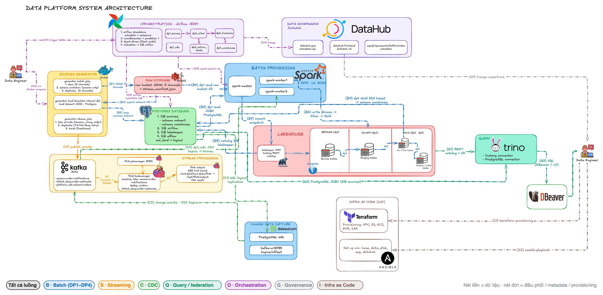

# Omnichannel Lakehouse

Personal project Data Engineering cho e-commerce 5 kênh: Walmart, Amazon,
TikTok Shop, Shopee và Lazada. Local-first, triển khai từng luồng end-to-end.



## Trạng thái

Đã có core storage, generator batch/load và Iceberg + Lakekeeper chạy trên Spark cluster.
Job Bronze nghiệp vụ và Airflow chưa triển khai.
Chi tiết: [implementation status](docs/implementation-status.md).
Kế hoạch giai đoạn tiếp theo: [TODO — Phase 3](TODO.md).

## Bắt đầu phát triển

Cần Python 3.11 và GNU Make. Python 3.12 được hỗ trợ cho scaffold checks.

```sh
make setup
make env
make check
make help
```

`make setup` cài công cụ phát triển vào `.venv`. `make env` tạo `.env` nếu chưa có.
Các target batch/stream chưa triển khai sẽ báo lỗi rõ ràng. Không cần Docker để chạy unit test.

## Chạy core storage

Cần Docker Engine/Desktop với Compose và kết nối internet cho lần build đầu.

```sh
make env
make up-core
make smoke-core
make init-core
make restart-core
make verify-persistence-core
```

PostgreSQL: `localhost:5432`; MinIO API: `localhost:9000`; console: `localhost:9001`.
Credential được sinh ngẫu nhiên trong `.env`, không ghi vào Git. `make down` giữ volume.
MinIO build từ source release đã pin vì image public không tải được; lần đầu có thể
mất vài phút. Xem [runbook](docs/runbook.md) để xử lý Docker credential helper trong WSL.

## Sinh dữ liệu nguồn

Sau khi core chạy, thực hiện:

```sh
make build-generator
make gen-sources
make verify-sources
```

Nếu đã cài core từ trước, chạy `make init-core` để bổ sung quyền bảng tạm cho generator.
Dataset mặc định có 15.600 dòng JSONL trên MinIO (15.000 đơn duy nhất) và 3.000 đơn
Walmart trong PostgreSQL. Chạy lại cùng config không nhân đôi dữ liệu.

[Hướng dẫn generator](docs/generators.md) · [Kết quả kiểm chứng](docs/generator-validation.md).
Streaming và pipeline Spark/Airflow chưa triển khai.

## Chạy Lakehouse (Phase 3)

```sh
make env-batch
make build-batch
make up-batch
make smoke-lakehouse
make restart-lakehouse
make verify-lakehouse
make verify-objects-lakehouse
```

Lakekeeper: http://localhost:8181/ui/ · Spark master UI: http://localhost:8080.
`make down` dừng core + batch, giữ volume. Chạy các lệnh smoke/verify tuần tự.
Chi tiết: [runbook](docs/runbook.md), [bằng chứng kiểm thử](docs/lakehouse-validation.md),
[hợp đồng Bronze giai đoạn sau](docs/bronze-contract.md).

## Kiến trúc và source

- `generators/`: dữ liệu batch, OLTP load, stream và cấu hình tái lập.
- `spark/`: Bronze → Silver → Gold, feature/label và CDC.
- `flink/`: event-time, late event, dedup, burst.
- `airflow/`: DAG điều phối và kiểm thử.
- `docker/`: Compose và image theo từng phase.
- `sql/`: PostgreSQL, Iceberg, Trino.
- `datahub/`: metadata ingestion và lineage.
- `infra/`: Terraform và Ansible.
- `observability/`: cấu hình metrics/dashboard theo phase.
- `docs/`: [plan gốc](docs/plan.md), [data model](docs/data-model.md),
  [ADR](docs/adr/), [runbook](docs/runbook.md), benchmarks.

Ưu tiên Walmart batch → Iceberg Gold → Trino, sau đó Airflow và các kênh còn lại.
Streaming, CDC, governance và AWS triển khai sau MVP batch.
Các điểm làm rõ so với plan được ghi riêng trong ADR; plan gốc được giữ nguyên.
