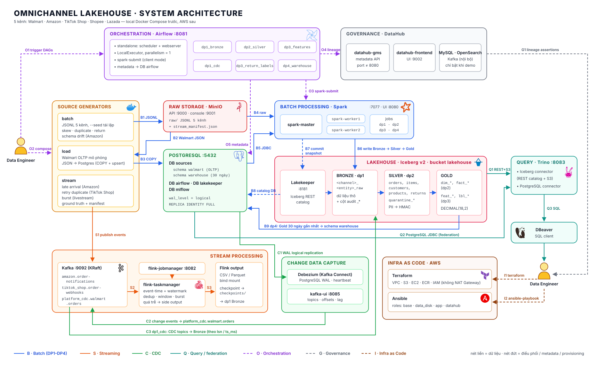
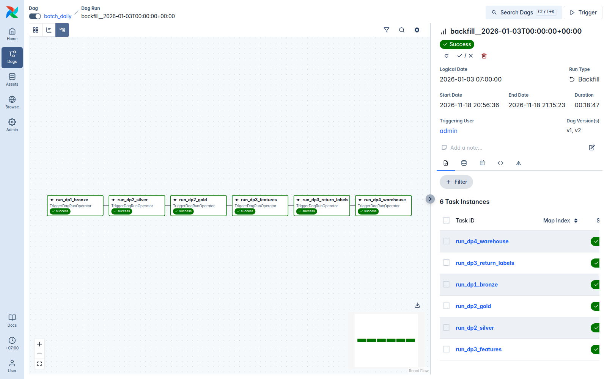

# Omnichannel Lakehouse

Personal project Data Engineering cho e-commerce 5 kênh: Walmart, Amazon,
TikTok Shop, Shopee và Lazada. Local-first, triển khai từng luồng end-to-end.



Chi tiết luồng và bản Mermaid: [docs/architecture.md](docs/architecture.md).

## Trạng thái

Đã có core storage, generator batch/load và Iceberg + Lakekeeper chạy trên Spark cluster.
Đã có `dp1_bronze` cho JSONL 5 kênh và JDBC Walmart, kèm replay/recovery và đối soát.
Phase 4B hoàn thành local (`v0.4b-silver`): Silver 5 entity/5 kênh, HMAC PII, quarantine, replay và recovery.
Phase 4C hoàn thành local (`v0.4c-gold`): Kimball star schema 8 bảng trong `lh.gold`, đối soát tiền tệ `DECIMAL(18,2)`, multi-dataset coexistence và atomic recovery.
Phase 4D hoàn thành local (`v0.4d-features`): Feature Store (`feat_customer_daily`, `feat_product_daily`) và Return Labels (`lbl_order_return`) trong `lh.gold` với point-in-time dual-timestamp cutoff và maturity right-censoring.
Phase 4E hoàn thành local (`v0.4e-warehouse`): Downstream Data Warehouse Export (`dp4_warehouse`) đồng bộ cửa sổ trượt 30 ngày sang PostgreSQL `warehouse.*` bằng một giao dịch JDBC nguyên tử (`spark_writer`), giữ nguyên vẹn ràng buộc PK/FK, `NUMERIC(18,2)` và quyền đọc `trino_ro`.
Phase 4F hoàn thành local (`v0.4f-benchmark`): benchmark skew có kiểm soát (AQE, broadcast, salting,
partition) trên dataset tới ~1M dòng, 240 trial đều đúng kết quả; giữ cấu hình Spark production
vì không biến thể nào nhanh hơn ổn định. Phase 4 đã đóng.
Phase 5 hoàn thành local (`v0.5-orchestration`): Airflow 3.3.2 điều phối toàn chuỗi batch theo ngày
(`batch_daily`), backfill 3 ngày chạy lại cho cùng kết quả, một Spark driver tại một thời điểm.
Phase 6 hoàn thành local (`v0.6-query`): Trino 484 chỉ đọc trên Iceberg + PostgreSQL, che PII,
8 query mẫu, đối soát Trino = Spark = ledger = warehouse, DBeaver/JDBC.
Phase 7 hoàn thành local (`v0.7-stream`): Kafka 4.3.2 (KRaft) + Flink 2.2.1 (job Java) xử lý
event trễ, trùng và burst exactly-once, có ground truth, phục hồi từ checkpoint, nạp vào Bronze.
Phase 8 hoàn thành local (`v0.8-cdc`): Debezium 3.6 đưa thay đổi của `walmart.orders` qua Kafka vào
Bronze CDC và Silver trạng thái hiện tại (xoá mềm, đúng thứ tự LSN), đối soát PostgreSQL ↔ Silver.
Phase 9 hoàn thành local (`v0.9-governance`): DataHub 1.7 (dùng lại PostgreSQL và Kafka) catalog
PostgreSQL, Iceberg, Kafka và Airflow; lineage nguồn → Bronze → Silver → Gold → warehouse (batch, stream,
CDC) phát từ ledger; tag `PII`, domain, glossary, owner quản lý bằng code; assertion G1.
Tiếp theo là Phase 10 (AWS, Terraform/Ansible).
Chi tiết: [implementation status](docs/implementation-status.md).
Checklist: [Phase 4B](docs/phase4b-checklist.md) · [Phase 4C](docs/phase4c-checklist.md) · [Phase 4D](docs/phase4d-checklist.md) · [Phase 4E](docs/phase4e-checklist.md) · [Gold validation](docs/gold-validation.md) · [DP3 validation](docs/dp3-validation.md) · [Warehouse validation](docs/warehouse-validation.md) · [Handoff 4D/4E](docs/features-warehouse-handoff.md) · [Phase 4F](docs/phase4f-checklist.md) · [Skew benchmark](docs/benchmarks/skew.md) · [Bàn giao Phase 5](docs/phase5-handoff.md) · [Phase 5](docs/phase5-checklist.md) · [Bàn giao Phase 6](docs/phase6-handoff.md) · [Phase 6](docs/phase6-checklist.md) · [Bàn giao Phase 7](docs/phase7-handoff.md) · [Phase 7](docs/phase7-checklist.md) · [Streaming](docs/streaming-validation.md) · [Bàn giao Phase 8](docs/phase8-handoff.md) · [Phase 8](docs/phase8-checklist.md) · [CDC](docs/cdc-validation.md) · [Bàn giao Phase 9](docs/phase9-handoff.md) · [Phase 9](docs/phase9-checklist.md) · [Governance](docs/governance-validation.md) · [Bàn giao Phase 10](docs/phase10-handoff.md).

## Bắt đầu phát triển

Cần Python 3.11 và GNU Make. Python 3.12 được hỗ trợ cho scaffold checks.

```sh
make setup
make env
make check
make help
```

`make setup` cài công cụ phát triển vào `.venv`. `make env` tạo `.env` nếu chưa có.
Các target batch/stream chưa triển khai sẽ báo lỗi rõ ràng. Không cần Docker để chạy unit test.

## Chạy core storage

Cần Docker Engine/Desktop với Compose và kết nối internet cho lần build đầu.

```sh
make env
make up-core
make smoke-core
make init-core
make restart-core
make verify-persistence-core
```

PostgreSQL: `localhost:5432`; MinIO API: `localhost:9000`; console: `localhost:9001`.
Credential được sinh ngẫu nhiên trong `.env`, không ghi vào Git. `make down` giữ volume.
MinIO build từ source release đã pin vì image public không tải được; lần đầu có thể
mất vài phút. Xem [runbook](docs/runbook.md) để xử lý Docker credential helper trong WSL.

## Sinh dữ liệu nguồn

Sau khi core chạy, thực hiện:

```sh
make build-generator
make gen-sources
make verify-sources
```

Nếu đã cài core từ trước, chạy `make init-core` để bổ sung quyền bảng tạm cho generator.
Dataset mặc định có 15.600 dòng JSONL trên MinIO (15.000 đơn duy nhất) và 3.000 đơn
Walmart trong PostgreSQL. Chạy lại cùng config không nhân đôi dữ liệu.

[Hướng dẫn generator](docs/generators.md) · [Kết quả kiểm chứng](docs/generator-validation.md).
Streaming và Airflow chưa triển khai; Spark Bronze/Silver đã chạy local.

## Chạy Lakehouse (Phase 3)

```sh
make env-batch
make build-batch
make up-batch
make smoke-lakehouse
make restart-lakehouse
make verify-lakehouse
make verify-objects-lakehouse
```

Lakekeeper: http://localhost:8181/ui/ · Spark master UI: http://localhost:8080.
`make down` dừng core + batch, giữ volume. Chạy các lệnh smoke/verify tuần tự.
Chi tiết: [runbook](docs/runbook.md), [bằng chứng kiểm thử](docs/lakehouse-validation.md),
[hợp đồng Bronze giai đoạn sau](docs/bronze-contract.md).

## Chạy Silver (Phase 4B)

```sh
make env-silver
make build-generator build-batch
make up-batch
make prepare-silver-fixture
make integration-silver
make test-silver-dq
make test-silver-recovery
make reconcile-silver
make verify-silver
```

Chạy tuần tự trên fixture riêng (375 orders). Dataset mặc định 15.000 orders dùng
`make integration-silver-reference`, sau khi đã ingest đủ Bronze như runbook.
`make verify-silver` chỉ đọc snapshots trong completed ledger; không publish lại.
Giữ nguyên HMAC key/version trong `.env` khi replay. Xem
[validation](docs/silver-validation.md), [runbook](docs/runbook.md) và
[Gold handoff](docs/gold-handoff.md).

## Chạy Gold (Phase 4C)

```sh
make smoke-gold
make verify-gold
make test-gold-dq GOLD_RUN_ID=186ae107d0793d2ee237
make test-gold-dq GOLD_RUN_ID=b1e64afaff0176de180a
make reconcile-gold GOLD_RUN_ID=186ae107d0793d2ee237
make reconcile-gold GOLD_RUN_ID=b1e64afaff0176de180a
make test-gold-recovery
```

Cả hai dataset (small fixture 375 đơn và default reference 15.000 đơn) cùng tồn tại
trong `lh.gold.*` (tổng 15.375 đơn). Đối soát tiền tệ `DECIMAL(18,2)` khớp tuyệt đối
giữa Gold, Silver và Bronze. Xem [Gold validation](docs/gold-validation.md) và
[Handoff Phase 4D/4E](docs/features-warehouse-handoff.md).

## Chạy Feature Store & Return Labels (Phase 4D)

```sh
make smoke-features
make verify-features
make smoke-labels
make verify-labels
make integration-dp3
make test-dp3-dq DP3_RUN_ID=186ae107d0793d2ee237
make test-dp3-dq DP3_RUN_ID=b1e64afaff0176de180a
make test-dp3-recovery
```

Xuất bản `lh.gold.feat_customer_daily`, `lh.gold.feat_product_daily` và `lh.gold.lbl_order_return`
với ledger độc lập tại `/runtime/dp3/publication/ledger.json`. Đảm bảo point-in-time cutoff kép
(`order_ts < as_of_ts` và `return_ts < as_of_ts`) và maturity censoring (`is_mature = false` → `is_returned IS NULL`).
Xem [ADR-0010](docs/adr/0010-features-and-return-labels.md) và [DP3 validation](docs/dp3-validation.md).

## Chạy Data Warehouse Export (Phase 4E)

```sh
make smoke-warehouse
make verify-warehouse
make integration-warehouse
make reconcile-warehouse
make test-warehouse-dq
make test-warehouse-recovery
```

Đồng bộ cửa sổ trượt 30 ngày `[run_date - 29 days, run_date + 1 day)` UTC của 8 bảng Gold
từ snapshot đã pin sang PostgreSQL database `sources`, schema `warehouse.*` trong một
giao dịch JDBC nguyên tử (`spark_writer`), bảo toàn `NUMERIC(18,2)`, PII hash và quyền đọc
cho `trino_ro` cùng ledger độc lập `/runtime/warehouse/export/ledger.json`. Xem
[ADR-0011](docs/adr/0011-warehouse-export.md) và [Warehouse validation](docs/warehouse-validation.md).

## Chạy Airflow (Phase 5)

```sh
make env-orch
make build-orch
make up-orch            # UI: http://localhost:8081 (admin / AIRFLOW_ADMIN_PASSWORD trong .env)
make smoke-orch
make test-dags
make e2e                # backfill batch_daily 2026-01-01..03 hai lần qua Airflow
```



Mỗi job có một DAG cùng tên (`dp1_bronze` … `dp4_warehouse`); `batch_daily` gọi lần lượt cho cùng
ngày logic. `maintenance_iceberg` chỉ báo cáo snapshot có thể dọn (không xóa gì, ADR-0014);
chạy tay bằng `make iceberg-report`. Airflow chạy `spark-submit` client mode, dùng chung ledger và khóa driver với `make`.
Xem [ADR-0013](docs/adr/0013-airflow-orchestration.md), [runbook](docs/runbook.md) và
[kiểm chứng](docs/orchestration-validation.md).

## Chạy DataHub (Phase 9)

```sh
make up-gov              # core + Lakekeeper + Kafka + DataHub (OpenSearch, GMS không port host, UI 127.0.0.1:9002)
make smoke-gov           # 15 kiểm tra: health, đăng nhập, ghi/đọc/xoá entity thử, topic, quyền chỉ đọc, secret
make gov-refresh         # 3 recipe chỉ đọc + lineage từ ledger + lineage job Airflow + metadata-as-code
make gov-assert          # G1: Gold ← Silver ← Bronze ← nguồn, warehouse ← Gold, stream, CDC, cạnh ledger + drift metadata
make gov-idempotency     # chạy lại toàn bộ, inventory phải giống hệt
```

Đăng nhập UI bằng user `datahub`, mật khẩu sinh ra trong `.local-data/governance/user.props`
(không commit). DataHub nặng ~3,5 GiB: chỉ chạy cùng core + Kafka (`make up-gov-orch` thêm Airflow cho
DAG `datahub_ingest`), không cùng Spark/Flink/Trino. Ingestion không đọc dòng dữ liệu (role
`datahub_ro` không có SELECT, tắt profiling). Thiết kế: [ADR-0018](docs/adr/0018-governance-datahub.md);
bằng chứng và ảnh lineage: [governance validation](docs/governance-validation.md).

## Chạy CDC (Phase 8)

```sh
make up-cdc              # PostgreSQL, Kafka, Kafka Connect + Debezium (không port host), đăng ký connector
make smoke-cdc           # slot, snapshot, chuỗi c/u/u/d theo thứ tự, không lộ secret, batch guard
make up-batch            # Spark cho dp1_cdc
make gen-cdc             # kịch bản INSERT/UPDATE/DELETE trên tiền tố riêng (không đụng 3 dataset batch)
make bronze-cdc silver-cdc verify-cdc   # Kafka → Bronze → Silver hiện trạng → đối soát PostgreSQL
make cdc-slot-lag        # giám sát replication slot
```

Connector chỉ bắt `walmart.orders` (không bắt `customers` có PII), tiền tệ dạng chuỗi decimal chính
xác; Bronze ghi bằng MERGE theo toạ độ Kafka nên chạy lại/replay không nhân đôi; Silver chỉ nhận bản
mới hơn theo `(lsn, offset)`. DAG `dp1_cdc` chạy mỗi 10 phút (pause khi tạo). Thiết kế:
[ADR-0017](docs/adr/0017-cdc-debezium.md); bằng chứng: [CDC validation](docs/cdc-validation.md).

## Chạy streaming (Phase 7)

```sh
make up-stream           # PostgreSQL, MinIO, Kafka 127.0.0.1:9092, kafka-ui :8085, Flink :8082 (không cần Spark/Airflow/Trino)
make smoke-stream        # topic, Flink ghi S3 qua plugin, quyền user flink, không lộ secret
make stream-acceptance   # job chạy trước, publish 6.312 record (50 rec/s), drain, đối soát ground truth, đóng run
make bronze-stream STREAM_RUN_ID=e7a188e49b1e4042ef15 STREAM_RUN_DATE=2026-02-01   # cần up-batch
```

Generator stream tất định (`generators/stream.yaml`) ghi ground truth vào
`s3://raw/manifests/<run>/`; job `amazon_late` (watermark 2 phút, window 5 phút, cho trễ 20 phút,
event quá trễ ra nhánh `late`) và `tiktok_dedup` (loại trùng theo `event_id`, TTL 30 phút) ghi JSON
Lines vào `s3://raw/stream/`, record hỏng vào DLQ Kafka. Thiết kế:
[ADR-0016](docs/adr/0016-streaming-kafka-flink.md); bằng chứng:
[streaming validation](docs/streaming-validation.md); số liệu: [benchmark](docs/benchmarks/streaming.md).

## Chạy Trino (Phase 6)

```sh
make up-query            # PostgreSQL, MinIO, Lakekeeper, Trino 127.0.0.1:8083 (không cần Spark/Airflow)
make smoke-query         # catalog, PII bị che, mọi lệnh ghi bị từ chối
make query-samples       # 8 query mẫu × mọi dataset
make verify-query        # cần thêm up-batch: Trino = Spark = ledger = warehouse
make query-sql SQL=sql/trino/02_top_sellers.sql PARAMS='dataset_run_id=b1e64afaff0176de180a'
```

Trino chỉ đọc (`iceberg.silver`, `iceberg.gold`, `postgresql.walmart`, `postgresql.warehouse`);
`iceberg.bronze` (PII thô) và `iceberg.benchmark` bị ẩn, `walmart.customers.full_name/email` hiển
thị `[redacted]`. Kết nối DBeaver: [docs/dbeaver.md](docs/dbeaver.md). Thiết kế:
[ADR-0015](docs/adr/0015-trino-query-layer.md); bằng chứng: [query validation](docs/query-validation.md).

## Benchmark data skew (Phase 4F)

```sh
make test-benchmark
make benchmark-dataset
make verify-benchmark-dataset
make benchmark-skew BENCH_CONFIG=smoke      # matrix-100k | matrix-1m | focus-1m | ci
make verify-benchmark BENCH_CONFIG=smoke
make report-benchmark BENCH_CONFIG=smoke
```

Dataset benchmark được nhân bản tất định từ Gold đã pin (`lh.benchmark.*`, không phải ingestion
end-to-end), mỗi trial là một Spark application riêng, so sánh với B0 bằng `exceptAll` và tổng
DECIMAL. Không ghi Gold/ledger nghiệp vụ. Xem [kết quả](docs/benchmarks/skew.md),
[ADR-0012](docs/adr/0012-skew-benchmark.md) và [runbook](docs/runbook.md).

## Kiến trúc và source

- `generators/`: dữ liệu batch, OLTP load, stream và cấu hình tái lập.
- `spark/`: Bronze → Silver → Gold, feature/label và CDC.
- `flink/`: event-time, late event, dedup, burst.
- `airflow/`: DAG điều phối và kiểm thử.
- `docker/`: Compose và image theo từng phase.
- `sql/`: PostgreSQL, Iceberg, Trino.
- `datahub/`: metadata ingestion và lineage.
- `infra/`: Terraform và Ansible.
- `observability/`: cấu hình metrics/dashboard theo phase.
- `docs/`: [plan gốc](docs/plan.md), [data model](docs/data-model.md),
  [ADR](docs/adr/), [runbook](docs/runbook.md), benchmarks.

Ưu tiên Walmart batch → Iceberg Gold → Trino, sau đó Airflow và các kênh còn lại.
Streaming, CDC, governance và AWS triển khai sau MVP batch.
Các điểm làm rõ so với plan được ghi riêng trong ADR; plan gốc được giữ nguyên.

Bronze Phase 4A: `make smoke-bronze` exercises Walmart JSONL and all
5 JDBC tables with replay and verification. See [Bronze validation](docs/bronze-validation.md)
and [runbook](docs/runbook.md); kết quả kiểm chứng chi tiết được lưu trong báo cáo validation.
