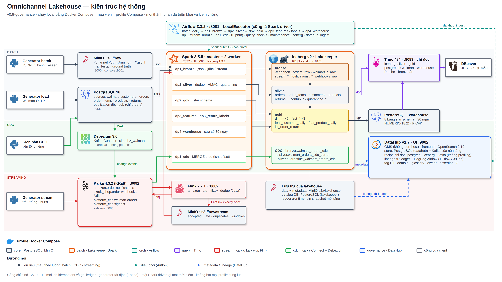
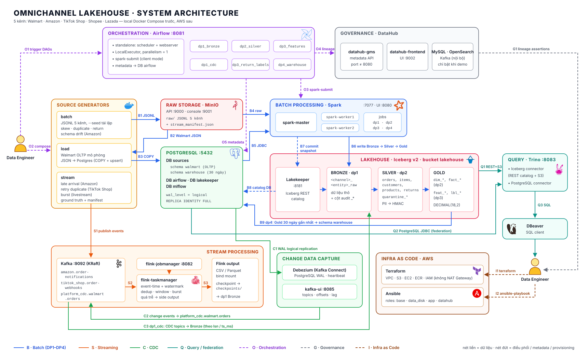
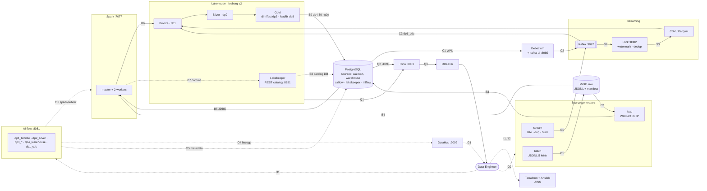

# Kiến trúc hệ thống

## Hệ thống hiện tại

Nguồn: [architecture-current.drawio](architecture-current.drawio) (mở bằng draw.io / app.diagrams.net hoặc
extension draw.io của VS Code; logo được nhúng sẵn trong file). Bản SVG vẽ tay tương đương:
[architecture-current.svg](architecture-current.svg).

Chỉ gồm thành phần đã triển khai và kiểm chứng (đến `v0.9-governance`); màu viền là profile Docker
Compose, ba làn batch / CDC / streaming, tên job, bảng, topic và cổng đúng như trong repo. Cập nhật
hình này khi thêm hoặc đổi một thành phần.

## Sơ đồ theo plan gốc (tham khảo)

Sơ đồ vẽ từ plan gốc ([plan](plan.md)), trước khi triển khai; hệ thống hoàn chỉnh là hình ở trên.

Nhãn luồng (B/S/C/Q/O/G/I) khớp bảng §4.2 trong [plan](plan.md). Port theo
`AGENTS.md` §5. Nét liền là dữ liệu; nét đứt là điều phối, metadata hoặc provisioning.
Sơ đồ mô tả kiến trúc đích; trạng thái triển khai xem
[implementation status](implementation-status.md).

Logo được nhúng trực tiếp trong SVG để GitHub render được; nhãn hiệu thuộc chủ sở hữu
tương ứng và chỉ dùng để nhận diện công nghệ:

- [Simple Icons](https://simpleicons.org) v13.21.0 (CC0): Airflow, Docker, MinIO,
  PostgreSQL, Spark, Trino, DBeaver, Kafka, Flink, Terraform, Ansible.
- Logo chính thức từ repo dự án (nhúng dạng data URI): DataHub
  (`datahub-project/datahub`), Debezium (`debezium/debezium.github.io`, cắt phần biểu tượng),
  Apache Iceberg (`apache/iceberg`, `iceberg-logo-icon.png`), Lakekeeper
  (`lakekeeper/lakekeeper`).
- Python (bản draw.io): biểu tượng `Logo_Python` của IBM Carbon Icons (Apache-2.0), lấy qua icon
  service của draw.io; bản draw.io dùng lại đúng các logo trên, nhúng dạng data URI.

## Bản rút gọn (Mermaid)

Dùng để chỉnh nhanh khi thay đổi luồng; khi đổi kiến trúc, cập nhật cả
`architecture.svg` để hai bản không lệch nhau.

