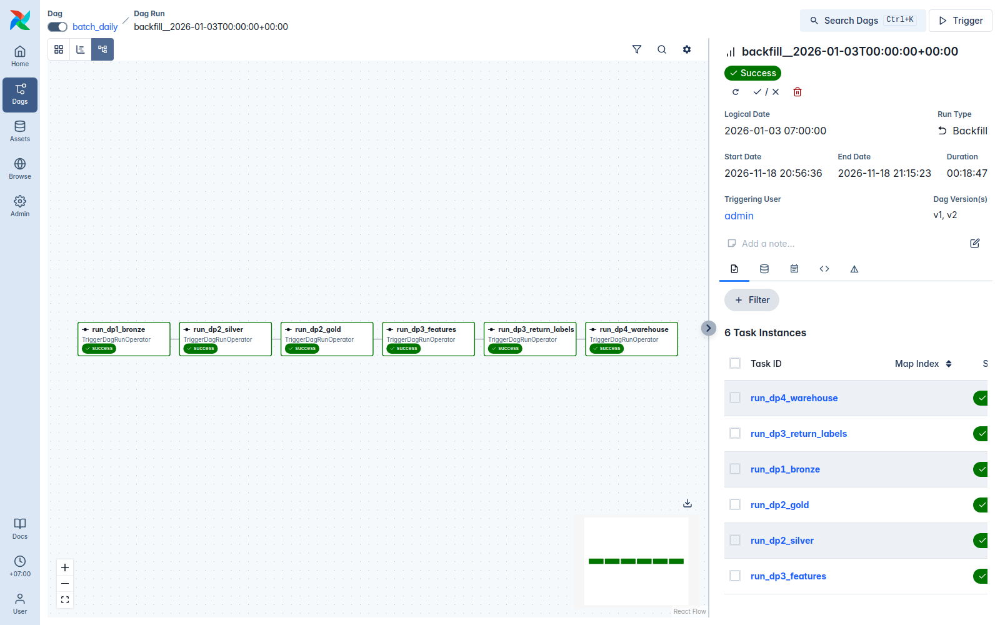

# Orchestration validation (Phase 5)

Evidence for [ADR-0013](adr/0013-airflow-orchestration.md). Commands run sequentially on
core + batch (+ orch from P5-04); raw logs stay local.

## P5-01 — Preflight baseline (2026-11-18)

- Start point: tag `v0.4f-benchmark` + plan commit `17ddc95`; `make check` green; Spark image
  rebuilt from source after the Phase 5 Spark changes.
- `verify-gold` (both datasets), `verify-features` (small), `verify-labels` (default),
  `verify-warehouse` and `test-review-regressions` (22 cases): all rc=0 (11–62 s each).
- Ledger SHA-256 before Phase 5 (unchanged since Phase 4F):

| Ledger | SHA-256 |
|---|---|
| `silver/publication/ledger.json` | `7abd65660a49b1665e6304c10d025e3f79d9bf26e0066f01004ddf773b4fe512` |
| `gold/publication/ledger.json` | `332aa2908ccd0c8788d88c31742e3d9e71805b43b6e4b41bd01417a56d7a5df3` |
| `dp3/publication/ledger.json` | `011ba719eddb289a0a04ba10aa4b8ec710b62e2b63a80b856948e89a79201a6b` |
| `warehouse/export/ledger.json` | `62b2e92f5ddabd9161c06ad001620c93d4c69304bff89c5ca601b6a21b7c4750` |

- Slices per dataset and date: Bronze JSONL for 5 channels + Walmart JDBC; Silver 5 channels;
  Gold/DP3/warehouse per run (dates 2026-01-01..03).
- Memory (`docker stats`, 5 s samples during the verifies): peak per container — workers
  781/796 MiB, driver 623 MiB, MinIO 258 MiB, master 210 MiB, PostgreSQL 156 MiB,
  Lakekeeper 14 MiB; sum of peaks ≈ 2.8 GiB. `mem_limit` total for core + batch ≈ 7.5 GiB on a
  ~11.7 GiB Docker host, leaving room for an Airflow container capped at 3 GiB (standalone +
  one driver JVM) while the `spark-submit` service is idle.
- Measured job durations used for timeouts: see [Phase 5 handoff](phase5-handoff.md) §3
  (Gold ~121 s, DP3 ~56 s, warehouse ~931 s full on the default dataset, replays 39–91 s).

## P5-03 — Shared driver lock

- `python -m spark.lib.driver_lock -- <cmd>` wraps every Spark submission in the Makefile.
- With a container holding `/runtime/locks/spark-driver.lock`, `make verify-warehouse` printed
  `{"event": "spark_driver_busy", ...}` and failed (inner exit 75); after releasing the lock the
  same command passed (`warehouse_verified`).
- Airflow tasks use `--wait 300`: with a container holding the lock for 150 s, the first Bronze
  task of a backfill waited (10:22:42 → lock released ~10:25:02) and succeeded on its first try
  (10:25:41). Before this change a 150 s hold exhausted the single retry and failed the run.

## P5-04 — Airflow image and profile

- `omnichannel/airflow:3.3.2-spark3.5.5` (Airflow 3.3.2, Python 3.11, Java 17, PySpark 3.5.5,
  jars copied from the Spark image). `make up-orch` from a stopped stack: `airflow-init`
  (`db migrate`, pool) then `airflow` healthy; `airflow-init` re-run is a no-op upsert.
- `make smoke-orch`: health endpoint (metadatabase, scheduler, triggerer, dag processor
  healthy), no DAG import errors, pool `spark_driver` = 1, and `smoke.py --verify` run from the
  Airflow container as Spark driver (`iceberg_verified`, executors connected back to `airflow`).
- Login: generated admin password accepted (HTTP 201 token), wrong password rejected (401);
  UI on `127.0.0.1:8081` only. `make restart-orch` keeps metadata (pool still present).
- Memory: Airflow ~1.0 GiB idle, ~2.1 GiB with a running driver (limit 3 GiB).

## P5-05 / P5-06 / P5-07 — DAGs

- 7 DAGs load without import errors: `dp1_bronze`, `dp2_silver`, `dp2_gold`, `dp3_features`,
  `dp3_return_labels`, `dp4_warehouse`, `batch_daily` (paused at creation, unpaused for backfill).
- `make test-dags` (in the image) and the CI-equivalent clean `python:3.11` + constraints run:
  7 passed. `make test` skips them when Airflow is not installed.
- A single `dp1_bronze` run for 2026-01-01 on the new dataset: 7/7 tasks success in ~5 min;
  task XCom holds the allowlisted summary (for example `bronze_completed` with metrics).

## P5-08 — End to end, idempotency and recovery

New dataset `5f552019ee41c24af95f` (`generators/fixtures/orchestration.yaml`, 20 orders per
channel per day) was generated with `make gen-sources` and ingested only through Airflow.

| Pass | Backfill | Result |
|---|---|---|
| 1 | `batch_daily` 2026-01-01..03, reprocess `failed` | 3/3 dates success, all children success, real publishes (Gold/DP3/warehouse `skipped=false`), 4,385 s |
| 2 | same, reprocess `completed`, expect unchanged | 3/3 success, but every ledger changed: Walmart JDBC re-ingested on every incremental run, giving Silver a new pin and republishing all layers with the same business rows |
| fix | Bronze JDBC incremental skips when per-table snapshot evidence is unchanged (ADR-0007) | live check: `bronze_skipped` `reason=source_unchanged` |
| A | reprocess `completed` after fixes 1–6, with lock held 150 s at start and an Airflow restart mid-run | 3/3 success; lock wait and restart recovery shown below |
| B | reprocess `completed`, expect unchanged | Silver/Gold unchanged (`skipped=true`), DP3/warehouse still republished → finding 7 |
| C | reprocess `completed` after fix 7 (repairs DP3 dates of the e2e run) | 3/3 success, 3,466 s; only the DP3 ledger changed (dates 01-01/01-02 recomputed, 01-03 skipped); Gold and all warehouse exports skipped |
| **D** | **reprocess `completed`, expect unchanged** | **3/3 success, 3,285 s, every Gold/DP3/warehouse step `skipped=true`, all four ledger SHA-256 unchanged — `make e2e` criterion met** |

Ledger SHA-256 after pass D: Silver `51d0f9d6…dd49f2`, Gold `be2e5d29…38bd085`, DP3
`42f49aa9…1d55eb34e`, warehouse `cfa1cdf5…70c217b`. First ingest through Airflow ≈ 24 min per
logical date for this fixture; a full no-op replay ≈ 18 min per date, dominated by ~15 Spark
application start-ups per date (each ~20–40 s).

Findings fixed during this step (each with tests):

1. Controller failure on a date whose per-job DAG already had a manual run (one run per DAG
   and logical date): documented in the runbook; the manual test run was deleted.
2. A failed date let the backfill continue with later dates: controller tasks now use
   `depends_on_past=True`.
3. Warehouse reconciliation failed once another dataset published Gold: pinned older Gold
   publications are now read from their immutable archive.
4. Warehouse task XCom was empty because its events carry a log prefix: the event filter now
   reads the JSON after the prefix (still allowlisted).
5. Daily replays re-ingested JDBC and cascaded new pins (see table).
6. A manual job holding the driver lock longer than one retry failed the backfill: bounded wait.
7. Pass B (after fix 5) kept Silver and Gold unchanged but republished DP3 and the warehouse:
   per-date DP3 with `--mode full` replaced the whole run (the e2e run kept only 2026-01-03),
   and older dates re-exported the warehouse window. DAGs now use DP3 `--mode incremental` and
   warehouse `--no-regress` (ADR-0011 addendum, ADR-0013); other datasets were not affected.

Recovery checks:

- Driver lock held by another container: Airflow task waits, then succeeds (see P5-03).
- `make restart-orch` while `bronze_tiktok_shop_jsonl` was running (10:26:13): the interrupted
  try was marked failed at 10:31:53 (heartbeat timeout), the retry succeeded at 10:32:19, the
  deferred controller task resumed after the restart, and no second driver ran.
- Missing manifest: `dp1_bronze` for a non-existent dataset run waited in
  `up_for_reschedule` without starting any Spark task, while `dp2_gold` ran to success in the
  meantime (the sensor holds no slot). The run was then failed manually; the 30-minute sensor
  timeout itself was not waited out.
- Coexistence after the new dataset: `verify-gold` for all three datasets, `verify-features`,
  `verify-labels`, `verify-warehouse` and `reconcile-warehouse` (three runs) pass;
  `test-review-regressions` (22 cases) and `test-warehouse-review` pass.

## Final checks (2026-11-18)

- E2E dataset: DP3 has dates 2026-01-01..03 for features and labels (plus 2026-01-18 labels
  triggered through `dp3_return_labels` for maturity); `test-gold-dq`, `reconcile-gold`,
  `test-dp3-dq`, `test-warehouse-dq` pass for `5f552019ee41c24af95f`.
- All datasets: `verify-gold`, `verify-features`, `verify-labels`, `verify-warehouse`,
  `reconcile-warehouse` (3 runs), `test-review-regressions` (22 cases) pass.
- `make smoke-orch`, `make test-dags` (7 tests), `make check` (lint + unit tests) pass.
- Hosted CI: `Scaffold checks` run
  [44335729476](https://github.com/tri21723/omnichannel-lakehouse/actions/runs/44335729476) on
  commit `b528ae3` (push, 2026-11-18): jobs `check` and `dags` (DagBag on Airflow 3.3.2 with
  constraints) both succeeded. The manual workflows `Airflow orchestration e2e` and
  `Skew benchmark smoke` had no recorded run at that time and are not claimed.

## Remaining Phase 5 items (completed after the first close)

### UI evidence

Captured with a headless Chromium (Playwright in a throwaway venv) that logs in through the
normal login form; authentication was not disabled. Pass D runs for 2026-01-03:

| View | File |
|---|---|
| `batch_daily` graph (6 chained triggers, all success) | [batch_daily-graph.png](images/phase5/batch_daily-graph.png) |
| `batch_daily` Gantt (all tries over time; Silver is the longest step) | [batch_daily-gantt.png](images/phase5/batch_daily-gantt.png) |
| `dp1_bronze` graph (sensor + 6 Bronze tasks) | [dp1_bronze-graph.png](images/phase5/dp1_bronze-graph.png) |
| `dp2_silver` Gantt | [dp2_silver-gantt.png](images/phase5/dp2_silver-gantt.png) |

### Assets

The last publish/verify task of each per-job DAG emits a layer asset (`lh.bronze`,
`lh.silver`, `lh.gold.star_schema`, `lh.gold.features`, `lh.gold.labels`,
`sources.warehouse`). They are informational (UI "Assets" tab); no DAG is scheduled on them.
A `dp2_gold` run recorded an event for `iceberg://lakekeeper/lh/gold/star_schema` from
`gold_verify`. `make test-dags`: 9 passed (asset and maintenance contracts included).

### `maintenance_iceberg` (ADR-0014, dry run)

- `make iceberg-report`: 142 tables in `bronze/silver/gold/benchmark`, 1,973 snapshots, 1,382
  pinned snapshot IDs from 0 unreadable pin sources, 1,653 small files (< 8 MiB), 0 expiry
  candidates with the default 7-day retention (the project is younger than 7 days).
- With `--retention-days 1` (still report only): 289 candidates, **0 overlap with pinned
  snapshots**; e.g. `lh.bronze.walmart_orders_raw` 81 snapshots, 41 pinned, 33 candidates.
- Airflow: unpausing `maintenance_iceberg` ran `scheduled__2026-11-15` to success and wrote
  `/runtime/maintenance/iceberg-report-2026-11-15.json`; the DAG was paused again afterwards.
- No `expire_snapshots`, `remove_orphan_files` or `rewrite_data_files` call exists in the code
  (asserted by the DAG test for the rendered command).

## Fresh-environment reproduction (2026-11-19)

The first hosted run of `Airflow orchestration e2e`
([44449903218](https://github.com/tri21723/omnichannel-lakehouse/actions/runs/44449903218), commit
`3fe9364`) failed in `smoke-orch`: it only verifies the Iceberg smoke fixture, which a fresh runner
does not have. The workflow now runs `make smoke-lakehouse` first (creates once, then verifies).

The whole workflow was then reproduced locally in an isolated Compose project (own `.env` and
volumes; the real volumes were untouched):

| Pass | Result |
|---|---|
| build, `up-orch`, `test-dags`, `smoke-lakehouse`, `smoke-orch` | pass |
| 1: ingest 2026-01-01..03 | success, 0 problems, 3,929 s; every layer published |
| 2: replay, expect unchanged | **failed**: only the DP3 ledger changed; features/labels for 01-01 and 01-02 republished, 01-03 and all Gold/warehouse steps skipped |
| 3: replay, expect unchanged | success, 2,342 s, no ledger changed, all 12 publish steps skipped |
| `restart-orch`, `smoke-orch` | pass |

Cause: DP3 pins the latest Gold publication. During ingest, 01-01 and 01-02 recorded the Gold
publication current at that time; after 01-03, the first replay sees a newer publication and
recomputes those dates (after pass 2 all nine table/date scopes point to the same Gold
publication). This is the same behaviour as pass C above, which was then read as a repair
specific to fix 7; it is in fact inherent to any fresh backfill, and the system converges after
one replay. `make e2e` now runs three passes (ingest; replay where only the DP3 ledger may change;
replay where nothing may change) and the workflow timeout is 300 minutes. See the ADR-0013
addendum.
