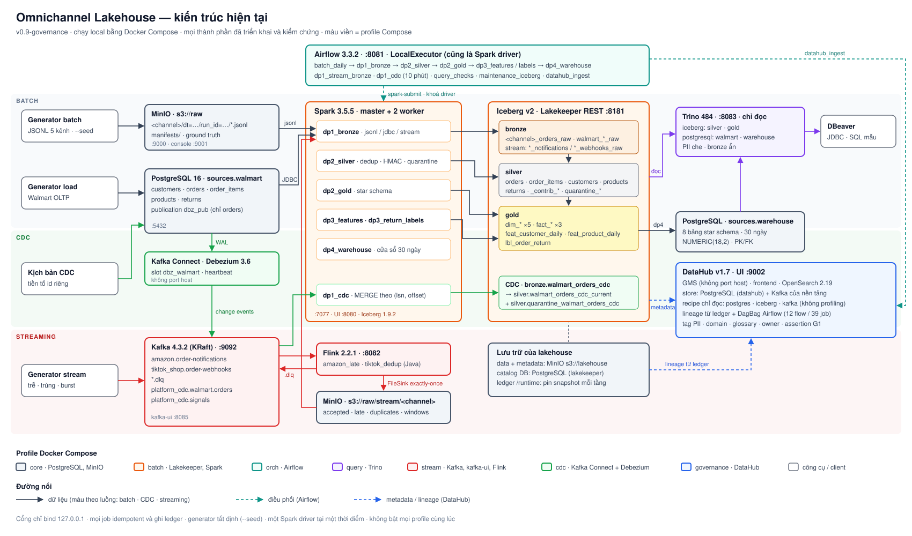
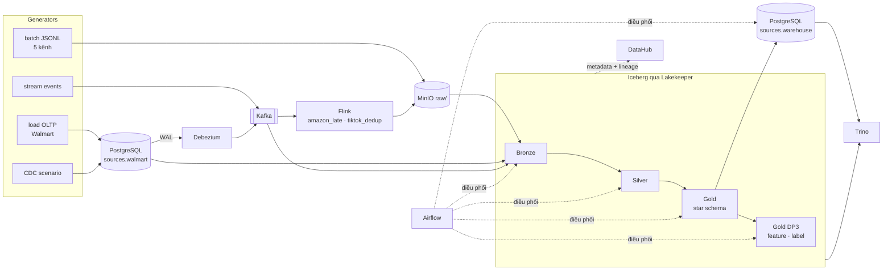
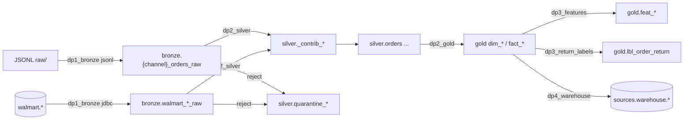
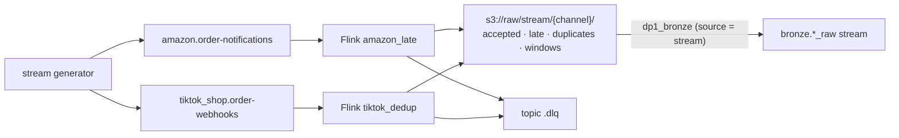
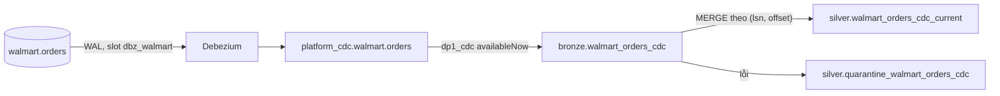
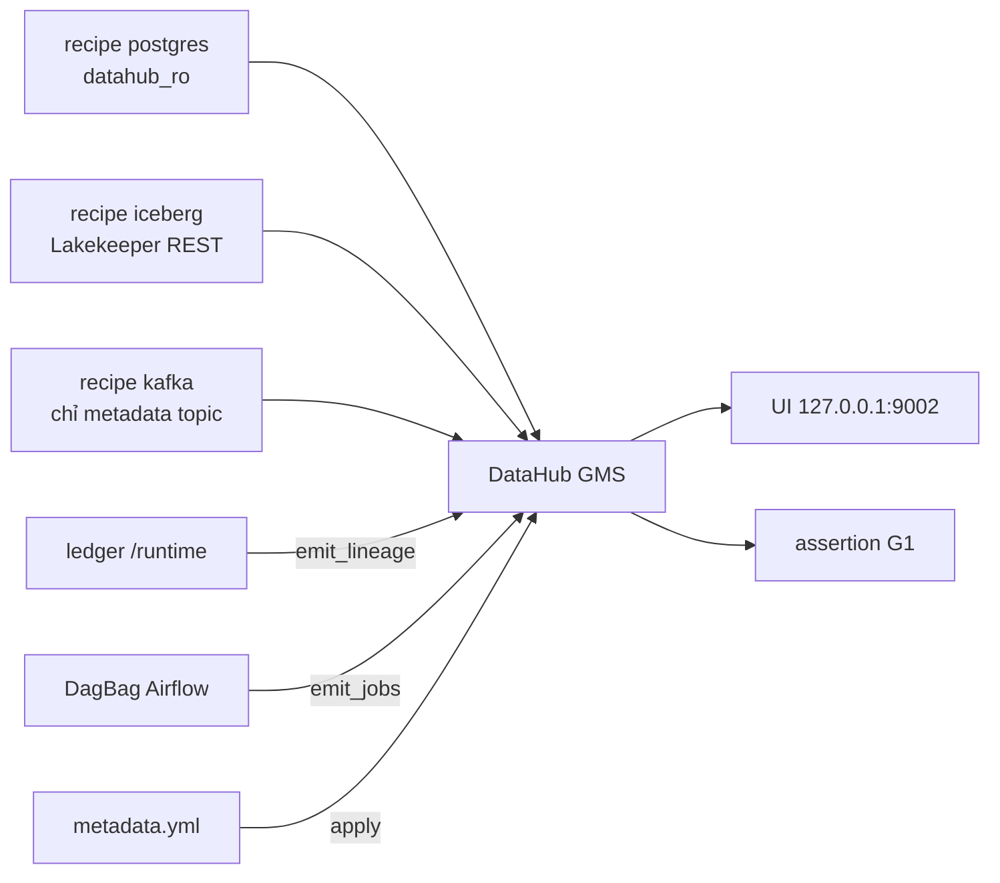

# Omnichannel Lakehouse — tổng quan dự án

Tài liệu này mô tả toàn bộ dự án ở một chỗ: mục tiêu, kiến trúc, dữ liệu đi qua hệ thống như thế
nào ở từng luồng, các nguyên tắc thiết kế, cách chạy và trạng thái hiện tại. Chi tiết của từng phần
nằm trong ADR và các tài liệu kiểm chứng được liên kết ở cuối mỗi mục.

Cập nhật: **2026-11-20** (sau Phase 9, tag `v0.9-governance`).

---

## 1. Dự án làm gì

Một nền tảng dữ liệu cho thương mại điện tử **đa kênh**: 5 kênh bán hàng (Walmart, Amazon,
TikTok Shop, Shopee, Lazada) đổ dữ liệu vào một lakehouse chung, được làm sạch, mô hình hoá thành
star schema, sinh feature cho ML, xuất sang data warehouse, truy vấn bằng SQL và được quản trị
(catalog, lineage, PII).

Toàn bộ hệ thống **chạy local bằng Docker Compose**; phần AWS (Phase 10)
đang tạm hoãn vì chi phí.

Các bài toán kỹ thuật chính mà dự án chứng minh được:

| Bài toán | Cách giải trong dự án |
|---|---|
| Nguồn không đồng nhất (JSONL khác schema theo kênh, OLTP, stream, CDC) | Bronze giữ nguyên payload, Silver chuẩn hoá theo contract chung |
| Dữ liệu trùng, đến trễ, lệch schema, skew | Generator cố ý sinh ra, pipeline phải xử lý đúng và có ground truth để đối chiếu |
| Chạy lại không được nhân đôi | Mọi job idempotent (MERGE / overwrite theo slice), có ledger ghi bằng chứng |
| Tầng sau đọc đúng phiên bản tầng trước | Ledger pin snapshot Iceberg của tầng upstream |
| Event trễ trong streaming | Flink event-time + watermark, side output cho event quá trễ, không bỏ dữ liệu |
| Thứ tự thay đổi CDC | Áp dụng theo vị trí WAL (`lsn`) và offset Kafka, xoá mềm |
| PII | Hash HMAC từ Silver, che cột trong Trino, tag `PII` trong DataHub |
| Lineage kiểm chứng được | Phát từ ledger, assertion G1 tự động fail khi thiếu cạnh |

---

## 2. Công nghệ và phiên bản (đã pin)

| Thành phần | Phiên bản | Vai trò |
|---|---|---|
| PostgreSQL | 16 | Nguồn OLTP Walmart, warehouse, metadata của Airflow/Lakekeeper/DataHub |
| MinIO | build từ source release đã pin | Object storage (thay S3): `raw`, `lakehouse`, `checkpoints` |
| Apache Iceberg | 1.9.2 (format v2) | Định dạng bảng của lakehouse |
| Lakekeeper | đã pin (ADR-0001) | Iceberg REST catalog |
| Apache Spark | 3.5.5 (master + 2 worker) | Xử lý batch và CDC |
| Apache Airflow | 3.3.2 (standalone, LocalExecutor) | Điều phối, đồng thời là Spark driver |
| Trino | 484 | Query engine chỉ đọc |
| Apache Kafka | 4.3.2 (KRaft) | Message bus cho stream và CDC |
| Apache Flink | 2.2.1 (job viết bằng Java) | Xử lý stream |
| Debezium | 3.6.3.Final (Kafka Connect) | CDC từ WAL PostgreSQL |
| DataHub | v1.7.0.1 (CLI 1.7.0.19), OpenSearch 2.19.3 | Catalog, lineage, metadata |

Nguồn và lý do chọn từng phiên bản: [ADR-0001](adr/0001-versions.md).

---

## 3. Kiến trúc tổng thể



Hình trên là hệ thống đang chạy: chỉ gồm thành phần đã triển khai, màu viền theo profile Compose,
chia làn batch / CDC / streaming. Kiến trúc đích (gồm AWS) nằm ở [architecture.svg](architecture.svg).

Toàn bộ luồng dữ liệu, rút gọn:



Các tầng của lakehouse (namespace Iceberg):

| Namespace | Nội dung | Ai ghi |
|---|---|---|
| `bronze` | Dữ liệu thô từ mọi nguồn + cột audit `_ingest_ts`, `_source_file`, `_channel`, `_batch_id` | `dp1_bronze`, `dp1_cdc` |
| `silver` | 5 entity chuẩn hoá (`orders`, `order_items`, `customers`, `products`, `returns`), bảng `_contrib_*`, `quarantine_*`, Silver CDC | `dp2_silver`, `dp1_cdc` |
| `gold` | Star schema (5 dim + 3 fact), feature (`feat_*`), label (`lbl_order_return`) | `dp2_gold`, `dp3_features`, `dp3_return_labels` |
| `benchmark` | Dữ liệu và kết quả benchmark skew | job benchmark |

---

## 4. Hạ tầng local

### 4.1 Profile Docker Compose

Mỗi cụm dịch vụ là một profile, bật bằng một lệnh `make up-*`. **Không bật tất cả cùng lúc**
(máy dev 16–32 GB RAM).

| Profile | Dịch vụ | RAM đo được | Lệnh |
|---|---|---|---|
| `core` | PostgreSQL, MinIO | 0,2–0,7 GiB | `make up-core` |
| `batch` | Lakekeeper, Spark master + 2 worker | ~2,5 GiB khi chạy | `make up-batch` |
| `orch` | Airflow (kèm Spark driver, venv DataHub CLI) | 1,2–2,1 GiB | `make up-orch` |
| `query` | Trino chỉ đọc | ~1,75 GiB | `make up-query` |
| `stream` | Kafka, kafka-ui, Flink | Kafka 0,5 · Flink 1,4 GiB | `make up-stream` |
| `cdc` | Kafka Connect + Debezium | ~0,5 GiB | `make up-cdc` |
| `governance` | DataHub (OpenSearch, GMS, frontend) | ~3,5 GiB | `make up-gov` |

`make down` dừng mọi profile và **giữ volume**.

### 4.2 Port (chỉ bind `127.0.0.1`, AGENTS.md §5)

| Dịch vụ | Port |
|---|---|
| PostgreSQL | 5432 |
| MinIO API / console | 9000 / 9001 |
| Lakekeeper | 8181 |
| Spark master / UI | 7077 / 8080 |
| Airflow | 8081 |
| Flink JobManager | 8082 |
| Trino | 8083 |
| Kafka | 9092 (trong container: `kafka:29092`) |
| kafka-ui | 8085 |
| DataHub UI | 9002 (GMS không mở port ra host) |

Kafka Connect cũng không mở port host (8083 đã thuộc Trino).

### 4.3 Bí mật và tài khoản

- Mọi credential được **sinh ngẫu nhiên** vào `.env` (`make env`, `env-batch`, `env-gov`, …), không
  bao giờ xoay vòng giá trị đã có, không commit. `.env.example` là nguồn sự thật cho tên biến.
- Mỗi thành phần dùng role/user riêng với quyền tối thiểu, ví dụ:

| Tài khoản | Quyền |
|---|---|
| `generator` (PostgreSQL) | ghi bảng nguồn Walmart |
| `spark_reader` / `spark_writer` | đọc nguồn JDBC / ghi warehouse |
| `trino_ro` | chỉ đọc `walmart`, `warehouse` (cột PII bị che trong Trino) |
| `datahub_ro` | chỉ `USAGE` schema, **không SELECT** → không đọc được dòng dữ liệu |
| MinIO `trino_local` | chỉ đọc bucket `lakehouse` |
| MinIO `flink_local` | ghi `raw/stream` |

---

## 5. Dữ liệu nguồn (generator)

Generator viết bằng Python, **cùng `--seed` cho ra cùng output**; tỉ lệ trùng, trễ, skew đọc từ YAML
(`generators/config.yaml`).

| Generator | Đầu ra | Đặc điểm cố ý |
|---|---|---|
| `batch` | JSONL 5 kênh trên `s3://raw/<channel>/dt=YYYY-MM-DD/run_id=<id>/part-*.jsonl` + `stream_manifest.json` | trùng 4%, trễ 5%, skew (một seller chiếm 50%), schema drift từ ngày 2 (Amazon), khác format timestamp (Shopee), trường optional (Lazada), 10% đơn có return |
| `load` | 5 bảng OLTP `sources.walmart.*` (customers, products, orders, order_items, returns) | tách từ payload Walmart |
| `stream` | event lên Kafka (`amazon.order-notifications`, `tiktok_shop.order-webhooks`) + ground truth | trễ có kiểm soát, trùng, burst |
| `cdc` | INSERT/UPDATE/DELETE trên `walmart.orders` với **tiền tố id riêng** + ground truth | không bao giờ đụng 3 dataset batch |

Ba dataset batch cùng tồn tại và **không được ghi đè hay xoá**:

| Run ID | Vai trò | Quy mô |
|---|---|---|
| `186ae107d0793d2ee237` | small fixture | 375 đơn |
| `b1e64afaff0176de180a` | default reference | 15.000 đơn |
| `5f552019ee41c24af95f` | e2e qua Airflow | 300 đơn |

Hợp đồng dữ liệu: [data model](data-model.md), [generators](generators.md), ADR-0005.

---

## 6. Luồng batch (B1–B9) — đường đi chính của dữ liệu



### 6.1 Bronze — `dp1_bronze` (ADR-0007)

- **Đầu vào:** chọn rõ ràng một `run_id` + `channel` + `run_date` + `source` (`jsonl`, `jdbc` hoặc
  `stream`) qua manifest; không đọc "mọi thứ trong bucket".
- JSONL được copy có giới hạn về đĩa staging rồi Spark đọc; JDBC đọc `SELECT *` các bảng
  `walmart.*`.
- **Ghi:** `bronze.<channel>_orders_raw` (JSONL; Walmart JSONL vào `walmart_orders_export_raw`),
  `bronze.walmart_<entity>_raw` (JDBC). Giữ nguyên payload trong `_raw`, giữ cả bản trùng của nguồn,
  thêm `_parse_status` (valid/invalid/blank) và cột audit. **Không làm sạch ở Bronze.**
- **Idempotent:** thay thế nguyên tử theo slice (run/channel/date/source). Chế độ `incremental` bỏ qua
  slice đã hoàn tất với cùng input.
- **Bằng chứng:** completion record trong `/runtime/bronze/*.json` (hash manifest, hash input, snapshot
  từng bảng, số dòng) — chỉ ghi sau khi bảng đích đối soát khớp.

### 6.2 Silver — `dp2_silver` (ADR-0008)

- Đọc **đúng snapshot Bronze** đã pin trong completion record.
- Chuẩn hoá 5 entity với khoá có `channel` (ví dụ `(channel, order_id)`); timestamp UTC, tiền
  `DECIMAL(18,2)`, giữ nguyên tiền tệ gốc (không quy đổi FX).
- **Dedup** theo `updated_ts` + SHA-256 của bản ghi đã chuẩn hoá.
- **PII:** `full_name`, `email` → `name_hash`, `email_hash` (HMAC-SHA256, có `_pii_key_version`);
  Silver không bao giờ chứa tên/email rõ.
- **Bản ghi lỗi** vào `silver.quarantine_<entity>` kèm mã lý do (`_error_reason`), không drop im lặng.
- Ghi theo 2 bước: ứng viên từng slice vào `silver._contrib_<entity>`, rồi reduce thành
  `silver.<entity>`.
- **Ledger:** `/runtime/silver/publication/ledger.json` ghi mỗi slice: bảng Bronze + snapshot đầu vào,
  thống kê (`input`, `valid`, `rejected`, `winners`, `duplicate_losers`), snapshot đầu ra.

### 6.3 Gold — `dp2_gold` (ADR-0009)

- Đọc **một Silver publication đã pin** (id trong Gold ledger).
- Star schema Kimball 8 bảng: `dim_date`, `dim_channel`, `dim_customer`, `dim_product`, `dim_seller`,
  `fact_orders`, `fact_order_items`, `fact_returns`.
- Surrogate key là SHA-256 hex 64 ký tự (tách theo `_dataset_run_id` và `channel`), `date_key` là
  `YYYYMMDD`. Fact orders và fact returns tách riêng để tránh fan-out khi join.
- Kiểm tra số học: refund không vượt net amount của dòng, return không trước order.

### 6.4 Feature và label — `dp3_features`, `dp3_return_labels` (ADR-0010)

- `feat_customer_daily` (RFM, số đơn/chi tiêu 7–30 ngày, hành vi trả hàng) và `feat_product_daily`
  (tốc độ bán, doanh thu, tỉ lệ trả) theo `as_of_date`.
- `lbl_order_return`: `is_returned` trong `horizon_days` (mặc định 14). **Point-in-time:** chỉ dùng
  `order_ts < as_of_ts` và `return_ts < as_of_ts`; đơn chưa đủ thời gian quan sát có
  `is_mature = false`, `is_returned = NULL` (right-censoring, tránh rò rỉ nhãn).

### 6.5 Warehouse — `dp4_warehouse` (ADR-0011)

- Xuất 8 bảng star schema sang PostgreSQL `sources.warehouse.*` cho **cửa sổ trượt 30 ngày UTC**.
- Một giao dịch JDBC duy nhất (`spark_writer`): thành công toàn bộ hoặc rollback; giữ PK/FK,
  `NUMERIC(18,2) CHECK (>= 0)`; ghi `warehouse.export_state` và ledger `/runtime/warehouse/export/`.

### 6.6 Chuỗi ledger — xương sống của tính đúng đắn

```text
Bronze completion (snapshot Bronze)
   └─▶ Silver ledger: pin snapshot Bronze → publication id
         └─▶ Gold ledger: pin Silver publication id
               ├─▶ DP3 ledger: pin Gold publication id
               └─▶ Warehouse ledger: pin Gold publication id
```

Nhờ đó: chạy lại cùng tham số không đổi kết quả, mỗi tầng biết chính xác nó được tính từ phiên bản
nào của tầng trước, và lineage trong DataHub có thể đối chiếu với ledger.

---

## 7. Luồng streaming (S1–S3) — Phase 7 (ADR-0016)



- **Contract `stream-v2`:** watermark 2 phút, cửa sổ 5 phút, allowed lateness 20 phút, TTL dedup 30
  phút; event trễ 11–16 phút vẫn được nhận, ≥ 31 phút là quá trễ → side output/DLQ (không bỏ).
- `amazon_late`: xử lý event trễ theo event-time. `tiktok_dedup`: khử trùng webhook theo id với state
  có TTL.
- Exactly-once: checkpoint Flink + FileSink + DLQ transactional; phục hồi từ checkpoint đã kiểm chứng
  (`verify-stream --failover`).
- `make stream-close` đóng một run, ghi `stream_output_manifest.json`; DAG `dp1_stream_bronze` hoặc
  `dp1_bronze --source stream` nạp vào Bronze. Kết quả đối chiếu với ground truth của generator.

Bằng chứng: [streaming validation](streaming-validation.md), [benchmark](benchmarks/streaming.md).

---

## 8. Luồng CDC (C1–C3) — Phase 8 (ADR-0017)



- Chỉ bắt `walmart.orders` (publication `dbz_pub`), **không bắt `customers`** (có PII); `REPLICA
  IDENTITY FULL`, decimal truyền dạng chuỗi chính xác.
- Heartbeat bằng logical message (không lọt vào Kafka) để WAL không phình; theo dõi lag của slot.
- Bronze CDC: Spark Structured Streaming `availableNow`, `MERGE` theo toạ độ Kafka (topic, partition,
  offset) → Debezium at-least-once nhưng Bronze chỉ giữ mỗi event một lần.
- Silver CDC: trạng thái hiện tại của mỗi đơn, chỉ nhận bản **mới hơn theo `(lsn, offset)`**; delete là
  xoá mềm. `make verify-cdc` đối soát PostgreSQL ↔ Silver (số dòng, checksum, ground truth).
- DAG `dp1_cdc` chạy mỗi 10 phút (pause khi tạo). `make cdc-batch-guard` chứng minh 3 dataset batch
  không bị đụng tới.

Bằng chứng: [CDC validation](cdc-validation.md).

---

## 9. Điều phối — Airflow (O1–O3, Phase 5, ADR-0013)

| DAG | Việc làm |
|---|---|
| `batch_daily` (@daily) | Gọi lần lượt các DAG job dưới đây cho một ngày logic |
| `dp1_bronze` | Chờ manifest → Bronze JSONL 5 kênh + Walmart JDBC |
| `dp2_silver` | Silver cho 5 kênh |
| `dp2_gold` | Publish + verify Gold |
| `dp3_features`, `dp3_return_labels` | Publish + verify feature/label |
| `dp4_warehouse` | Export + verify warehouse |
| `dp1_stream_bronze` | Chờ manifest đầu ra stream → Bronze stream |
| `dp1_cdc` | Bronze CDC → Silver CDC → verify, mỗi 10 phút |
| `query_checks` | Kiểm tra warehouse qua Trino khi asset warehouse cập nhật |
| `maintenance_iceberg` (@weekly) | Báo cáo trạng thái bảo trì Iceberg (chỉ báo cáo) |
| `datahub_ingest` (@daily, pause khi tạo) | Recipe DataHub + lineage dataset + lineage job |

Quy tắc chung: `max_active_runs=1`, `retries`, owner `data-platform`, dùng `ds` thay vì
`datetime.now()`. **Mọi Spark driver** (từ `make` hoặc Airflow) đi qua khoá
`/runtime/locks/spark-driver.lock` và pool `spark_driver` (một driver tại một thời điểm). Backfill 3
ngày chạy lại cho cùng kết quả.

---

## 10. Truy vấn — Trino + DBeaver (Q1–Q3, Phase 6, ADR-0015)

- Catalog `iceberg` (qua Lakekeeper REST, MinIO user chỉ đọc) và `postgresql` (`trino_ro`).
- **Chỉ đọc tuyệt đối:** `iceberg.security=read_only`; schema `bronze`/`benchmark` bị ẩn; cột
  `full_name`, `email` bị che thành `[redacted]`.
- 8 query mẫu trong `sql/trino/`: doanh thu theo kênh/ngày, top seller, tỉ lệ trả theo category, query
  liên nguồn Walmart, đối chiếu warehouse ↔ Iceberg, time travel, metadata snapshot, độ chín của label.
- Đối soát Trino = Spark = ledger = warehouse. Kết nối DBeaver: [hướng dẫn](dbeaver.md).

---

## 11. Quản trị dữ liệu — DataHub (O4, G1, Phase 9, ADR-0018)



- **Catalog:** 14 bảng PostgreSQL, 41 bảng Iceberg (bronze/silver/gold), 5 topic Kafka, 7 prefix
  MinIO; 12 DataFlow / 39 DataJob của Airflow. Ingestion **không đọc dòng dữ liệu** (không profiling,
  role không có SELECT).
- **Lineage** dựng từ ledger và contract (không suy đoán lúc runtime): nguồn → Bronze → Silver → Gold
  → DP3 / warehouse, topic → Flink → Bronze stream, `walmart.orders` → topic CDC → Bronze → Silver CDC.
  Chuỗi stream/CDC chỉ được phát khi có bằng chứng chúng đã chạy.
- **Metadata-as-code** (`datahub/metadata/metadata.yml`): tag `PII` đúng 20 đối tượng chứa tên/email
  thô, tag tầng `bronze`/`silver`/`gold`, `raw`, `quarantine`; domain Sales/Returns/Features/Streaming/
  CDC; glossary 11 thuật ngữ; owner; mô tả bảng/cột.
- **G1** (`make gov-assert`): mỗi Gold có upstream Silver, mỗi Silver có upstream Bronze, mỗi Bronze có
  nguồn, warehouse có upstream Gold, stream/CDC đủ chuỗi, và **mọi cạnh tính từ ledger đều có trong
  DataHub**; fail ngay khi thiếu (đã kiểm chứng bằng test âm trên entity thử).
- Mọi bước phát metadata đều idempotent: chạy lại không đổi tập URN và không tạo phiên bản aspect mới.

Bằng chứng và ảnh UI: [governance validation](governance-validation.md).

---

## 12. Nguyên tắc thiết kế xuyên suốt

| Nguyên tắc | Cụ thể |
|---|---|
| Idempotent | `MERGE INTO` hoặc ghi đè theo slice; chạy lại cùng tham số không nhân đôi; có test chạy 2 lần |
| Bằng chứng trước khi công bố | Completion record / ledger chỉ ghi sau khi đối soát khớp |
| Pin snapshot | Tầng sau đọc đúng snapshot/publication tầng trước đã ghi trong ledger |
| Bronze thô, Silver sạch | Mọi làm sạch nằm ở Silver; Bronze chỉ thêm cột audit |
| Không drop im lặng | Bản ghi lỗi vào `quarantine_*` (batch, CDC) hoặc DLQ (stream) |
| Tiền tệ | `DECIMAL(18,2)` / `NUMERIC(18,2)`, không float, không quy đổi FX |
| PII | Hash HMAC từ Silver; che trong Trino; không profiling; tag trong DataHub |
| Quyền tối thiểu | Mỗi dịch vụ một role; các lớp đọc (Trino, DataHub) chỉ đọc |
| Pin version | Image/jar có version cố định (jar Spark kèm SHA-256); không tự ý nâng |
| Tài nguyên | Mỗi service có `mem_limit` + healthcheck; một Spark driver tại một thời điểm |
| Quyết định có ghi chép | 18 ADR trong `docs/adr/` |

---

## 13. Kiểm thử và CI

- **`make check`** (lint + unit test, không cần Docker): ruff, black, yamllint, sqlfluff và hơn 300
  test pytest (transform, contract, generator, lineage, metadata, allowlist log CI…).
- **`make test-dags`**: DagBag và contract DAG chạy trong image Airflow.
- **Smoke/verify/recovery** theo từng phase (`smoke-*`, `verify-*`, `test-*-recovery`), chạy tuần tự.
- **GitHub Actions:** `ci.yml` (Scaffold checks, tự chạy mỗi lần push) và các workflow thủ công cho
  từng luồng: `lakehouse`, `bronze`, `silver`, `gold-dp3`, `warehouse`, `benchmark`, `orchestration`,
  `query`, `stream`, `cdc`, `governance`. Log trên CI chỉ in **sự kiện JSON trong allowlist** (tên check,
  số đếm, hash), không in log thô hay dữ liệu.
- Trước khi bàn giao mỗi phase, workflow được tái hiện trên một **Compose project tách biệt** (môi
  trường trắng) rồi mới chạy trên GitHub.

---

## 14. Cấu trúc repo

```text
docker/          compose theo profile + Dockerfile (images/), script smoke/init theo profile
generators/      batch/, load/, stream/, cdc/, common/ + config YAML
spark/           jobs/{dp1_bronze, dp2_silver, dp3_features, dp3_return_labels, dp4_warehouse, dp1_cdc}
                 lib/ (IO, ledger, DQ, PII dùng chung), tests/
flink/           jobs/ (Java: amazon_late, tiktok_dedup)
airflow/         dags/, plugins/omnichannel/, tests/
sql/             postgres/ (DDL nguồn + warehouse), iceberg/ (contract), trino/ (query mẫu)
datahub/         recipes/, lineage/, metadata/, assertions/, tools/, requirements.lock
infra/           terraform/, ansible/ (khung rỗng, Phase 10)
observability/   (chưa triển khai)
docs/            adr/, *-validation.md, phase*-checklist.md, runbook, data-model, benchmarks/
```

---

## 15. Chạy thử nhanh (theo thứ tự)

Yêu cầu: Docker Engine/Desktop có Compose, Python 3.11, internet cho lần build đầu.

```sh
make setup check                 # công cụ dev + lint/test (không cần Docker)
make env up-core smoke-core      # PostgreSQL + MinIO
make build-generator gen-sources verify-sources     # sinh dữ liệu nguồn

make build-batch up-batch smoke-lakehouse           # Lakekeeper + Spark
make spark-submit JOB=dp1_bronze                    # hoặc các target integration-* theo phase
make up-orch                                        # Airflow :8081, chạy batch_daily / backfill

make up-query smoke-query                           # Trino :8083 (tắt Spark/Airflow nếu thiếu RAM)
make up-stream stream-acceptance                    # Kafka + Flink (bật riêng)
make up-cdc smoke-cdc                               # Debezium (bật riêng)
make up-gov smoke-gov gov-refresh gov-assert        # DataHub (bật riêng)
make down                                           # dừng tất cả, giữ volume
```

Hướng dẫn chi tiết từng luồng nằm trong [README](../README.md); xử lý lỗi: [runbook](runbook.md).

---

## 16. Trạng thái hiện tại

| Phase | Nội dung | Trạng thái | Tag |
|---|---|---|---|
| 0–2 | Nền tảng, core storage, generator | xong | — |
| 3 | Iceberg + Lakekeeper + Spark | xong | `v0.3-phase3` |
| 4A–4F | Bronze, Silver, Gold, feature/label, warehouse, benchmark skew | xong | `v0.4a-bronze` … `v0.4f-benchmark` |
| 5 | Airflow | xong | `v0.5-orchestration`, `v0.5.1-orchestration` |
| 6 | Trino + DBeaver | xong | `v0.6-query` |
| 7 | Kafka + Flink | xong | `v0.7-stream` |
| 8 | Debezium CDC | xong | `v0.8-cdc` |
| 9 | DataHub governance | xong | `v0.9-governance` |
| 10 | AWS (Terraform + Ansible) | **tạm hoãn** (chi phí) | — |
| 11 | Hoàn thiện: observability, bảo trì Iceberg, demo | chưa bắt đầu | — |

Còn để sau: observability (Prometheus/Grafana), bảo trì Iceberg thật (snapshot expiry, compaction,
dọn orphan file — hiện chỉ báo cáo), đọc JDBC song song, bảng seller riêng, quy đổi FX, quickstart
một lệnh được kiểm chứng "dưới 30 phút", video demo và bài viết tổng kết.

---

## 17. Tài liệu liên quan

- Kế hoạch gốc: [plan](plan.md) · Kiến trúc: [architecture](architecture.md) · Trạng thái chi tiết:
  [implementation status](implementation-status.md)
- Hợp đồng dữ liệu: [data model](data-model.md), [Bronze contract](bronze-contract.md),
  `sql/iceberg/*_contract.sql`
- Quyết định kỹ thuật: [docs/adr/](adr/) (ADR-0001 → ADR-0018)
- Kiểm chứng theo phase: `docs/*-validation.md`, checklist đã lưu `docs/phase*-checklist.md`
- Vận hành: [runbook](runbook.md) · Quy tắc làm việc: [AGENTS.md](../AGENTS.md)
