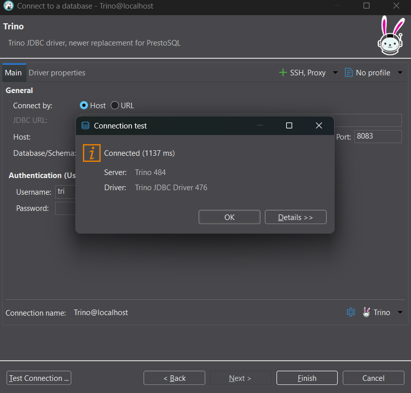
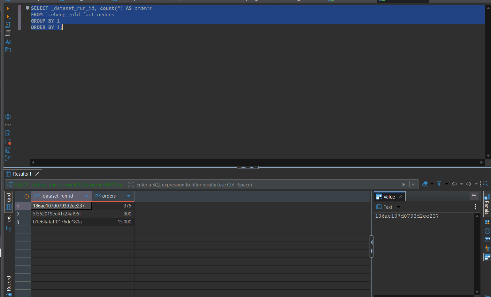

# Query layer validation (Phase 6)

Evidence for [ADR-0015](adr/0015-trino-query-layer.md). Commands run sequentially; raw logs
stay local.

## P6-01 — Preflight baseline (2026-11-18)

- Start point: `v0.5.1-orchestration` + commits `2d2fb56`, `e377d9f`; `make check` green
  (213 passed, 1 skipped).
- Read-only verification before any Trino work, all rc=0: `verify-gold`, `verify-features`,
  `verify-labels` for `186ae107d0793d2ee237`, `b1e64afaff0176de180a`, `5f552019ee41c24af95f`,
  and `verify-warehouse`. Ledger hashes were identical before and after.

| Ledger | SHA-256 (baseline; Trino must not change any) |
|---|---|
| `silver/publication/ledger.json` | `51d0f9d6b6484afe85bfcf7fd96feb33029962e003f505cdbbe0a2d024dd49f2` |
| `gold/publication/ledger.json` | `be2e5d29338d192d4c48c45f9d610e9bdd027d39966cac9bdd4d5f0f338bd085` |
| `dp3/publication/ledger.json` | `146ab6abae87c2d12bd61cc29be5aefcf1d0f70b9c8ea0dbaa25959b0432db6f` |
| `warehouse/export/ledger.json` | `cfa1cdf5b16f5b3422dbdb171ad8e311d97ec6b19ba598799fd1a597270c217b` |

(The DP3 hash differs from Phase 5 pass D because `dp3_return_labels` was triggered for
2026-01-18 afterwards; see orchestration validation.)

### Expected values for reconciliation (from ledgers)

- Gold rows (all datasets): `fact_orders` 15,675, `fact_order_items` 15,675, `fact_returns`
  1,560, `dim_customer` 1,045, `dim_product` 268, `dim_seller` 268, `dim_date` 48,
  `dim_channel` 15. DP3: `feat_customer_daily` 3,135, `feat_product_daily` 804,
  `lbl_order_return` 47,025.
- Warehouse per run: `186ae107…` run_date 2026-01-17, 375 orders/items, 30 returns;
  `b1e64aff…` 2026-01-17, 15,000/15,000/1,500; `5f552019…` 2026-01-03, 300/300/2. Monetary
  totals per channel/currency are in `warehouse/export/ledger.json` → `runs.<run>.monetary`
  (e.g. default `amazon|USD` net 750,463.24, small `amazon|USD` net 20,379.33).

### Objects to expose and PII inventory

| Source | Content | PII | Decision |
|---|---|---|---|
| `lh.bronze` (13 tables) | Raw payloads: JSONL `_raw` embeds `customer.full_name/email`; JDBC rows include `walmart.customers` | **Raw PII** | Hidden from Trino (data model: raw stays restricted) |
| `lh.silver` (15 tables incl. `quarantine_*`, `_contrib_*`) | Typed entities; customers only `name_hash`, `email_hash` | Hashes only | Read-only |
| `lh.gold` (11 tables) | Star schema, features, labels | Hashes only | Read-only |
| `lh.benchmark` (103 tables) | Benchmark inputs/results, not a contract | Derived from Gold | Hidden |
| `sources.warehouse` | 30-day mirror of Gold | Hashes only | Read-only |
| `sources.walmart` | OLTP source | **`customers.full_name`, `customers.email`** | Read-only, these two columns masked |

Other `walmart` tables (`orders`, `order_items`, `products`, `returns`) have IDs, amounts and
timestamps only.

### Memory budget

With only PostgreSQL, MinIO and Lakekeeper running (Spark and Airflow stopped with
`docker compose stop`, nothing removed): PostgreSQL 224 MiB, MinIO 450 MiB, Lakekeeper 47 MiB
(limits 768 + 768 + 384 MiB); host available ≈ 8.8 GiB. A Trino container capped at 2.5 GiB
fits comfortably. Running `query` together with `batch` + `orch` raises total limits to
≈ 13 GiB on an ~11.7 GiB host, so the default `up-query` does not start Spark or Airflow.

## P6-02 — Version and ADR

- Trino 484 (`trinodb/trino:484`, published 2026-10-16, OpenJDK 25.0.4) pinned in ADR-0001;
  ADR-0015 records catalogs, security model, PII rules and read consistency.

## P6-03 — Service and Make targets

- `docker/compose.query.yml` (profile `query`), configuration in `docker/query/trino/etc`
  mounted read-only, secrets via `${ENV:…}` only, healthcheck = image `health-check`,
  `127.0.0.1:8083`, `mem_limit` 2.5 GiB, heap 1.5 GiB.
- `make up-query` from a stopped Trino: 36 s, healthy; `make restart-query` healthy; `make smoke-query`
  passes after both. Trino uses ~1.5 GiB of 2.5 GiB; with PostgreSQL, MinIO and Lakekeeper the
  query stack uses ~2.1 GiB (Spark and Airflow stopped).
- Catalogs: only `iceberg`, `postgresql`, `system` (image defaults `tpch`, `tpcds`, `memory`, `jmx`
  are not shipped).

## P6-04 — Read-only access, PII and exposed scope

`make smoke-query` (20 checks, all pass):

- Schemas visible: `iceberg` → `gold`, `silver`, `information_schema`; `postgresql` → `walmart`,
  `warehouse`, `information_schema`. `bronze` and `benchmark` are hidden and direct reads return
  `PERMISSION_DENIED`.
- Gold and warehouse counts per dataset through Trino: 375 / 15,000 / 300 orders, matching the
  ledgers; Iceberg metadata tables (`"fact_orders$snapshots"`) readable.
- PII: `SELECT full_name, email` and `SELECT *` on `postgresql.walmart.customers` return only
  `[redacted]` for both columns.
- Denied with `PERMISSION_DENIED`: CREATE TABLE/SCHEMA, INSERT, DELETE on both catalogs, `CALL`
  `unregister_table`, `ALTER TABLE … EXECUTE expire_snapshots` and `remove_orphan_files`.
- Credential layer: `make smoke-core` passes (Trino S3 user cannot write, `trino_ro` cannot delete).

### Incident found and fixed

The first smoke run showed `ALTER TABLE iceberg.gold.dim_channel EXECUTE
expire_snapshots(retention_threshold => '36500d')` was **not denied**: file-based access control
does not govern table procedures, and the REST commit was written by Lakekeeper. The probe used a
100-year threshold, so no snapshot qualified, but Lakekeeper still wrote a new metadata version
(`00004-…metadata.json`, 2026-11-18 15:51:37 UTC) for `lh.gold.dim_channel`. Impact check: both
snapshots are still present, the current snapshot `2146564618510487487` equals the Gold ledger,
`verify-gold` passes for all three datasets and all four ledger hashes equal the P6-01 baseline.
Fix: `iceberg.security=read_only` plus 36500d minimum retention for snapshot/orphan procedures;
after the fix both procedures are denied and no further metadata version was written.

## P6-05 — Sample queries and runner

- `sql/trino/01…08`: revenue per channel/day, top sellers (skew), return rate per
  category/currency, federated Gold ⋈ `walmart.orders`, warehouse vs Iceberg window, time travel,
  snapshot metadata, label maturity. Lint: `sql/trino/.sqlfluff` (dialect `trino`, placeholder
  templater), run from that directory by `make lint`.
- `docker/query/run_sql.py` (`make query-sql`) renders `:name` parameters as typed literals
  (`spark/lib/sql_params.py`); unsafe values are rejected (unit tests).
- `make query-samples`: 8 files × 3 datasets = 24 runs, all invariants pass (federated orders
  matched 3,000/3,000 with equal amounts on the default dataset; warehouse vs Iceberg diff 0.00;
  version and timestamp time travel equal; immature labels have `is_returned` NULL; hot seller
  = 50.0% of each channel). Review fixed queries 03 and 08, which summed money across currencies.

## P6-06 — Reconciliation (`make verify-query`)

The Spark job `spark/jobs/query_parity` runs the same SQL files at the ledger snapshots (Spark
temp views, `walmart.orders` via JDBC) and `docker/query/verify.py` runs them on Trino with
`FOR VERSION AS OF`. 38 checks, all pass, two full runs produced an identical `parity.json` and no
ledger changed:

| Check | Count | Result |
|---|---|---|
| Row count at ledger snapshot = ledger `content.rows` (Gold 8 + DP3 3 tables) | 11 | equal |
| Trino = Spark for files 01–04, 08 per dataset (two-way multiset) | 15 | equal |
| Warehouse money/rows: Iceberg slice (ADR-0011 rules) = `postgresql.warehouse` = ledger | 9 | equal (375 / 15,000 / 300 item rows; 5 channel/currency groups each) |
| Time travel at the older Gold publication `332aa290…` | 3 | e2e dataset 0 → 300 orders; other datasets unchanged |

## P6-07 — DBeaver / JDBC

`make query-jdbc-check` (Trino JDBC 484, SHA-1 verified) from the host: driver/server 484,
per-dataset counts 375 / 300 / 15,000, `email` = `[redacted]`, prepared statement 300, DELETE
denied. Template and walkthrough: [dbeaver.md](dbeaver.md).

DBeaver (Windows host, 2026-11-19, provided by the user): connection to `localhost:8083`
succeeded (`Connected (1137 ms)`, server Trino 484, DBeaver-downloaded driver Trino JDBC 476),
and the per-dataset order count returned 375 / 300 / 15,000, equal to the ledgers.

## P6-08 — Operations

- Lakekeeper stopped: Iceberg queries fail with `ICEBERG_CATALOG_ERROR`, PostgreSQL queries keep
  working; after Lakekeeper is healthy again Iceberg works without restarting Trino (once a single
  query right after start still failed; a second measurement recovered at 0 s).
- MinIO restarted: both catalogs work afterwards.
- Wrong S3 secret (temporary container env): `ICEBERG_INVALID_METADATA`, PostgreSQL still works,
  the secret value appears neither in the error nor in the Trino log; restored config passes
  `smoke-query` 20/20.
- Memory: query stack alone ≈ 2.2 GiB; during `verify-query` (Spark + Trino) peaks sum to
  4.8 GiB (Trino 1.75 GiB); all profiles idle ≈ 4.0 GiB used, 5.3 GiB host available. Running
  everything is possible for light work, but the summed `mem_limit` (~13 GiB) exceeds the host.
- Query during an Airflow publish (`dp3_return_labels` for the e2e dataset, new date 2026-01-10):
  `latest` changed from 900 to 1,200 labels while the pinned snapshot stayed at 900. This publish
  changed only the DP3 ledger (`b2d6892e…`); `verify-labels` and `verify-query` pass afterwards.

## P6-09 — `query_checks` DAG

Asset-scheduled on `sources.warehouse` (emitted by `dp4_warehouse` verify), paused at creation.
A manual asset event triggered it: `query_checks_reconciled` with 3 runs, 15 groups, 0 problems.
The shared Trino client now lives in `spark/lib/trino_http.py` (also used by host tools).

## Hosted CI

`Scaffold checks` run
[44355559275](https://github.com/tri21723/omnichannel-lakehouse/actions/runs/44355559275) on
commit `a11d318` (push, 2026-11-19): job `check` (lint incl. `sql/trino` with the Trino dialect,
unit tests incl. runner/parity/event tests) and job `dags` succeeded.

Manual workflow `Trino query layer` run
[44374160331](https://github.com/tri21723/omnichannel-lakehouse/actions/runs/44374160331) on
commit `3fe9364` (2026-11-19, ~16 min): all 18 steps succeeded on a fresh runner with only the
small fixture — build, Silver → Gold → DP3 → warehouse, `up-query`, `smoke-query`
(`QUERY_SMOKE_MIN_DATASETS=1`), `query-samples`, `verify-query`, `restart-query`, `smoke-query`.

Earlier attempts and fixes (no local data involved):

| Run | Failed step | Cause | Fix |
|---|---|---|---|
| 44357062344 | build Spark image | Maven Central HTTP 429 on shared runner IP | `b19cb09`: retry with backoff, checksum PostgreSQL JAR |
| (2nd) | `smoke-query` | checks assumed the 3 local datasets and existing benchmark tables | `3e7bfe4`: `--min-datasets`, absent benchmark probe allowed |
| (3rd) | `query-samples` | `summary['added-records']` fails on the empty creation snapshot | `3fe9364`: `ELEMENT_AT`, per-file error reporting |

The third failure was reproduced locally in an isolated Compose project (own `.env` and
volumes) before fixing; the reproduction volumes were removed afterwards.
